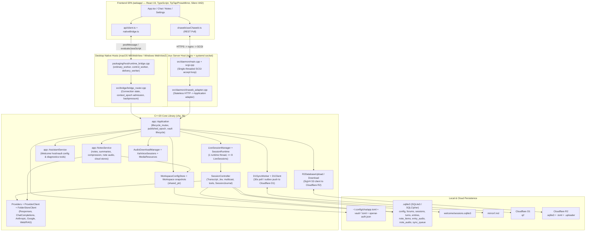
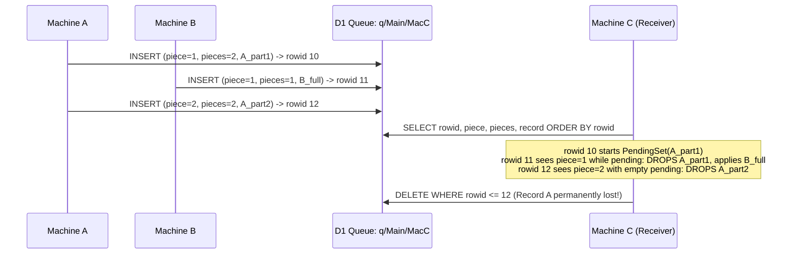

# CHA Architectural Review (`carbon-arch-review`)

**Review Date:** November 17, 2026  
**Scope:** Full-stack architectural and source-level review of `src/`, `webapp/`, `packaging/`, `CMakeLists.txt`, and `docs/*.md`  
**Governing Standard:** `AGENTS.md` — *CHA is a personal, single-user, non-enterprise application; every critique and recommendation is evaluated strictly through Keep It Simple (KISS).*

---

## 1. Executive Verdict

### Main Question: *Are there flaws in the design of the application that must be fixed?*

**Yes.** CHA's original core—its single-vault C++20 chat runtime, actor-like `SessionController`, immutable `Workspace` snapshots, `context_epoch`-fenced bridge protocol, and strict TypeScript DTO validation—is clean, readable, and well-engineered for a personal desktop and private-LAN application.

However, as major subsystems were layered onto that single-process, single-SQLite-file foundation—specifically **Cloudflare D1 multi-machine sync**, **multi-process (`main`/`secondary`) vault sharing**, **ProseMirror Notes with multi-hour Flex summarization and batch audio**, **Cloudflare R2 whole-vault transfer**, and **host-modifying Assistant tools**—several **structural design flaws and correctness bugs** emerged that can cause **silent data loss, cross-machine state corruption, permanent worker deadlocks, frozen UI/daemon threads, and features that appear to work in the UI while doing nothing underneath**.

Crucially, **fixing CHA does not require adding enterprise infrastructure** (no CRDT engines, message brokers, microservices, or complex lock managers). Nearly every severe flaw comes from *excess or half-finished machinery*, and the right fixes **delete state, collapse execution paths, and restore simple invariants**.

### Top Must-Fix Findings at a Glance

| Priority | Subsystem | Core Design Flaw | Impact | KISS Fix Direction |
| :--- | :--- | :--- | :--- | :--- |
| **P0 — Critical** | **D1 Sync (`d1_sync`, `d1_client`)** | Queue table `q/<vault>/<machine>` has schema `(piece, pieces, record)` with **no sender or batch ID**. Concurrent multi-piece sends from $\ge 2$ machines interleave by `rowid`. | Silent dropping of $>1.9\text{ MiB}$ records or splicing Piece 1 of Machine B onto Piece 2 of Machine A. | Add `batch_id TEXT NOT NULL` to queue rows (or chunk by `(batch_id, piece)`). |
| **P0 — Critical** | **D1 Sync (`d1_sync`)** | `handle_full_database()` drops the queue table with the highest **row count** across **all vaults** in D1; victim hits `missing_table` and logs only to `cha.log` with **zero UI status**. | Destroys an active machine's (or another vault's!) unsynced inbox while sync silently dies forever. | Never auto-drop peer queues across vaults; surface sync state (`ok` / `paused` / `error`) in UI and recover safely. |
| **P0 — Critical** | **D1 Sync & Vaults (`workspace_config_store`, `vault_operations`)** | (a) Settings `create_forum` omits `INSERT INTO forums`, so creator drops incoming D1 chats; (b) Notes sync by mutable `["Folder","Note"]` path, clobbering colliding notes and losing `folder_summary`; (c) Desktop R2 Download skips `clear_downloaded_inbox`; (d) Vault Rename orphans D1 queues. | Lost chats, overwritten notes, duplicated turns after R2 download, and broken sync after vault rename. | Populate `forums` in `create_forum`; give notes an immutable UUID; always clear/create D1 inbox on R2 download & rename. |
| **P0 — Critical** | **Multi-Process Vaults (`workspace_config_store`, `session_lease`)** | `secondary` processes keep a **frozen `Workspace` snapshot**, run RW startup DDL under a shared lock, write stranded D1 outbox rows, never promote when `main` exits, and force non-atomic `.cha-lock` upgrades (`change_mode`) that can brick `Application`. | `ForumNotFoundError`, stale prompts/keys, aborted live streams during maintenance checks, `unavailable` app state. | **Delete `secondary` mode.** Use one exclusive `.cha-lock` per vault (focus existing window or require separate vault). |
| **P0 — Critical** | **Providers / Flex (`notes_operations`, `provider_client`)** | Note compression & summary calls set `timeout_s = 0` (`CURLOPT_TIMEOUT = 0`), while `ProviderClient`'s `idle_timeout` is **unarmed until the first HTTP body byte arrives**. | Stalled Flex queue or half-open socket hangs worker forever, permanently deadlocking `compression_mutex` and leaking `Application` on exit. | Arm an activity/pre-first-byte deadline (e.g., 2–4h ceiling for Flex) and send `max_completion_tokens` instead of `max_tokens`. |
| **P1 — High** | **Notes Summaries (`summaries.ts`, `notes_service`)** | Canonical notes are ProseMirror JSON with no C++ Markdown parser, forcing multi-hour Flex folder `Summarize` and `Save summary` to be orchestrated by **browser JS behind a blocking modal**. | Closing/reloading the window or switching vaults mid-run loses L3 section progress; blocks entire UI for hours. | Move summary orchestration (or canonical Markdown/JSON conversion) to C++ `BackgroundJobs` with durable progress. |
| **P1 — High** | **Threading & SQLite (`application`, `live_session`, `daemon`)** | Startup blocks UI on network `D1SyncWorker::run_once()`; `SessionRuntime` runs SQLCipher 256k-iter PBKDF2 on **every `make_snapshot()`**, `synchronous = FULL` + `BEGIN IMMEDIATE` (even on `note_list`/`note_get`!), $O(\text{folder})$ annotation decompression on `note_save`, and kills live sessions on 5s `SQLITE_BUSY`; Jev waits up to 10s for `name_request_`; `cha-daemon` processes 1 SCGI request serially. | Startup beachballs, multi-second streaming stalls, killed sessions under load, 10s first-turn lag, 30s multi-tab daemon freezes. | Decouple startup sync & Jev naming; keep one keyed DB handle; fix read-only transactions & `synchronous = NORMAL`; bound SCGI pool. |
| **P1 — High** | **Storage Bloat (`workspace`, `note_storage`, `r2_database_transfer`)** | Base64 pictures live inside `Workspace::source_files_` (copied 3–4× in RAM on every Settings edit); multi-GB `note_audio`/`entry_audio` blobs live inside `vault.sqlite3`. | High RAM churn on tiny config edits; R2 Upload copies multi-GB DB while blocking UI, then `DELETE` + `VACUUM`s. | Store pictures outside `source_files_` (dedicated table) and keep regenerable audio cache in `vault.audio.sqlite3` or sidecar files. |
| **P2 — Medium** | **Security, Dead Features & Docs (`assistant_service`, `session_controller`, `docs/`)** | `Redactor` omits D1 `api_token`; Welcome mixes `web_read` with `host_config_write`; `page_url` allows loopback/LAN SSRF; `session_folders` (`##folder`) is **100% dead**; `/cover` is lost on session reload; Google/Anthropic `reasoning_effort` UI is a no-op; `docs/*.md` contradict current code. | Token leak / prompt injection risk in Welcome; misleading no-op UI features; maintainer confusion. | Add D1 token to `Redactor`, disable web tools in Welcome, block private IPs, delete dead `session_folders`/`history_epoch`/`web_reader_api_key`. |

---

## 2. System Architecture Overview

### 2.1 Purpose & Deployment Topologies

CHA is a local-first multi-character AI chat, long-form Notes, voice/audio, and RAG workspace built around a shared C++20 core (`cha_lib`) and a React 19 + TypeScript + TipTap frontend (`webapp/`). It ships in two deployment modes:

1. **Native Desktop (`Cha` on macOS, `cha.exe` on Windows):**
   - **macOS (`packaging/macos/main.swift`, `native_bridge.swift`):** Swift `@MainActor` `NSApplication` hosting `WKWebView`, serving bundled frontend assets via a custom `cha-app://app/` `WKURLSchemeHandler` (enforcing `Cross-Origin-Opener-Policy: same-origin` and `Cross-Origin-Embedder-Policy: require-corp` so ONNX/Silero VAD WebAssembly threads can use `SharedArrayBuffer`), and communicating with C++ through `packaging/host/runtime_bridge.cpp` (`WKScriptMessageHandler` + `evaluateJavaScript`).
   - **Windows (`packaging/windows/main.cpp`):** Win32 + WebView2 host mapping `https://app.cha.local/` to local `webui` assets, bridging JSON messages over `PostWebMessageAsJson` / `WebMessageReceived` through the same C ABI (`cha_runtime_*`).
2. **Private-Network Web Server (`cha-daemon` + `ChaWeb` on Linux):**
   - **Backend (`src/daemon/main.cpp`, `scgi.cpp`, `chaweb_adapter.cpp`):** Systemd socket-activated SCGI daemon behind nginx (`packaging/linux/nginx-chaweb.conf.example`, typically over WireGuard/Tailscale + HTTP Basic Auth), translating REST/JSON endpoints (`/api/chaweb/*`) onto `Application` and `LiveSessionManager` without using `BridgeRouter`.
   - **Frontend (`webapp/src/chaweb/useChaweb.ts`):** Same compiled React SPA booted in ChaWeb mode (`window.chaHost === undefined`), polling active sessions at 250 ms while generating and 5 s when idle.



### 2.2 Module & Layer Inventory

| Layer | Directories / Targets | Responsibilities |
| :--- | :--- | :--- |
| **Host & Transport** | `packaging/macos/`, `packaging/windows/`, `packaging/host/`, `src/bridge/`, `src/daemon/` | Native OS windows, custom URL schemes, C ABI runtime threads (`runtime_bridge.cpp`), stateful RPC/event multiplexing (`BridgeRouter`), and stateless Linux SCGI server (`cha-daemon`). |
| **Application Coordinator** | `src/app/` | `Application` facade, vault open/switch/create/copy/merge/protect/delete (`vault_operations.cpp`), R2 S3 SigV4 transfer (`r2_database_transfer.cpp`), D1 background sync (`d1_sync.cpp`, `d1_client.cpp`), `AssistantService` host/vault maintenance tools, `BackgroundJobs`, and `XaiVoiceSessions`. |
| **Session & Runtime** | `src/runtime/`, `src/session/`, `src/chat/`, `src/characters/` | `LiveSessionManager` and single-threaded `SessionRuntime`, `LiveSession` output coalescing, `SessionController` state machine (slash commands, `@handle` routing, Jev auto-selection, parallel multicast, tool callbacks, auto-naming), `Transcript` & `ModelHistory` projection, `.md` `SessionMirror`. |
| **Notes & Media** | `src/notes/`, `src/media/` | `NotesService` (CRUD, ProseMirror JSON zlib storage, Flex compression, L1/L2/L3 & session summary staging, web page/picture import, Gemini batch `note_audio` with Apple AudioToolbox / Windows Media Foundation AAC/M4A encoding, OpenAI/Google cloud folder stores), `AudioDownloadManager` (FishAudio & ElevenLabs HTTP/WS TTS), `MediaResources`. |
| **Providers & Auth** | `src/providers/` | `ProviderClient` (OpenAI Responses, Chat Completions, Anthropic Messages, Google Gemini `streamGenerateContent`), SSE framing, multi-round tool loop (`web_search`, `web_read`, `summary_search`, `summary_read`, `library_search`, `assistant_*`), `OpenAiOAuth` PKCE/device auth, `ApiKeyStore`. |
| **Workspace & Storage** | `src/workspace/`, `src/storage/`, `src/util/` | Immutable `Workspace` config loader/validator (`TOML` + Markdown templates), `WorkspaceConfigStore` transactional editor + single-step undo, `SqliteDatabase` (SQLite3 + SQLCipher amalgamation), `SessionJournal`, `SessionRepository`, `note_storage`, `sync_storage`, `sync_chat`, `SessionLease` file locks. |
| **Web UI** | `webapp/src/` | React 19 SPA, runtime boundary validators (`api/protocol.ts`), TipTap/ProseMirror rich editor (`notes/editor.ts`) with custom `annotation` mark / `noteComment` / `notePicture`, client-side summary & EPUB pipelines (`notes/summaries.ts`, `notes/epubImport.ts`), WebAudio/MSE voice I/O. |

### 2.3 Threading, Concurrency & Lock Model

CHA uses explicit OS threads and mutexes rather than an async coroutine runtime:

1. **Host UI Thread** (macOS `@MainActor` / Win32 message loop): Owns the WebView and native dialogs; invokes C ABI setup/teardown (`cha_runtime_create`, `cha_runtime_request_shutdown`, `cha_runtime_join_shutdown`) and non-blocking `cha_runtime_submit`.
2. **`runtime_bridge.cpp` Threads (3 threads on Desktop):**
   - `ordinary_worker`: Executes **all** ordinary `BridgeRouter` tasks sequentially (`1` thread).
   - `control_worker`: Executes control-plane tasks (`session.stop`, `session.unsubscribe`, `operation.cancel`, `media.release`, `notes.summary.cancel`).
   - `delivery_worker`: Drains `BridgeRouter::wait_for_delivery` (1-in-flight delivery acked by JS `chaHost.ack`).
3. **`SessionRuntime` Thread (1 thread):** Owns **all** `LiveSession` instances (`<= 8`) and `SessionController` state machines, interleaving `control_` futures, `WebCommand`s, and `ProviderRequest` streaming deltas (`src/runtime/live_session_manager.cpp:365-410`).
4. **Detached `Providers` Threads + Nested Tool Threads:** One detached `std::thread` per LLM generation, Jev classification, or session-naming call (`src/providers/providers.cpp:31-33`), plus up to 4 `std::async` threads per generation for parallel web tool calls (`src/providers/provider_client.cpp:854-876`).
5. **`BackgroundJobs` Threads:** Dynamic `std::thread` pool (`src/app/background_jobs.cpp`) running note compressions, summary LLM parts, Gemini batch audio workers, cloud folder-store uploads, xAI voice WebSockets, and R2 background uploads.
6. **`AudioDownloadManager` Pool (3 threads)** & **`D1SyncWorker` Thread (1 thread, 30 s cadence)**.

**Primary Lock Ordering:**
`BridgeRouter::mutex` (never held across `Application` work except fast atomic `check_context`) $\rightarrow$ `Application::Impl::lifecycle_mutex` (`std::timed_mutex`) $\rightarrow$ `SessionRuntime` (`std::future::get()` onto runtime thread) or `WorkspaceConfigStore::Impl::mutex` $\rightarrow$ SQLite/SQLCipher file & WAL locks (`busy_timeout = 5000 ms`).

---

## 3. Architectural Strengths to Preserve

Before cataloging flaws, it is important to recognize the design choices that work remarkably well and **should not be disturbed**:

1. **Actor-Like Confinement of `SessionController` (`src/session/session_controller.cpp`):** Within a single `LiveSession`, transcript mutations, slash commands, multicast state, and streaming deltas execute sequentially on `SessionRuntime` without per-field mutex soup.
2. **Immutable `Workspace` Snapshots (`std::shared_ptr<const Workspace>`):** Parsing and cross-validating all forums, characters, personas, providers, voices, and prompt templates into an immutable graph (`src/workspace/workspace.cpp`) before atomic publication (`WorkspaceConfigStore::snapshot()`) gives lock-free reads for in-flight requests within the `main` process.
3. **Explicit `context_epoch` Fencing (`src/bridge/bridge_router.cpp`, `webapp/src/api/client.ts`):** Every vault-bound bridge request, subscription, media handle, and background reply carries `context_epoch`. Vault switches and destructive maintenance bump `published_epoch`, cleanly rejecting stale late completions instead of corrupting the newly opened vault.
4. **Strict Boundary Validation on Both Sides of the Bridge:** `src/bridge/request_params.h` (`require_only_keys`, `as_safe_uint`) and `webapp/src/api/protocol.ts` validate every field at runtime rather than trusting `as SomeDto` TypeScript casts.
5. **Defense-in-Depth Markdown Rendering (`webapp/src/components/Markdown.tsx`):** Combining `stripMarkdownLinks` with `DOMPurify` (`FORBID_TAGS: ['a', 'img']`) and CSS injection guards eliminates classic LLM Markdown XSS/image-beacon exfiltration vectors.
6. **SQLite `STRICT` Tables & Private File Permissions:** Core tables use SQLite `STRICT` typing, SQLCipher encryption is cleanly integrated into the single-file amalgamation, and `private_filesystem` enforces `0700`/`0600` POSIX permissions and owner-only Windows ACLs.

---

## 4. Design Flaws That Must Be Fixed

### Part I — Critical Correctness, Data-Loss & Reliability Flaws (P0)

---

#### Flaw 1: Cloudflare D1 Sync Protocol Can Corrupt or Silently Lose Data

D1 sync (`src/app/d1_sync.cpp`, `src/app/d1_client.cpp`, `src/storage/sync_storage.cpp`, `src/storage/sync_chat.cpp`) treats per-machine D1 tables `q/<vault>/<machine>` as unkeyed text queues. Seven concrete design defects interact to cause silent data loss or state divergence:

##### 1.1 Multi-Sender Piece Interleaving Corrupts or Drops Records $>1.9\text{ MiB}$
- **Evidence:** `src/app/d1_client.cpp:212-214, 265-266, 283-297`; `src/app/d1_sync.cpp:165-178, 220-225, 375-409`.
- **Mechanism:** Queue tables have schema `(piece INTEGER NOT NULL, pieces INTEGER NOT NULL, record TEXT NOT NULL)` with **no `sender` or `batch_id` column**. `send_pass` slices any JSON record $>1.9\text{ MiB}$ (`sync_piece_bytes = 1,900,000`, e.g., a large note, EPUB chapter, or base64 character picture) and inserts each slice in a **separate HTTP POST** (`d1_sync.cpp:173`). `receive_pass` reads `SELECT rowid, piece, pieces, record ... ORDER BY rowid` and reassembles slices in a single `PendingSet` state machine (`d1_sync.cpp:220-225, 375-409`).
- **Failure Mode:** Whenever two machines (e.g., Desktop Mac + Laptop or ChaWeb server) concurrently send multi-piece (or 1-piece + 2-piece) records to a third machine's queue, D1 `rowid`s interleave:
  - **Silent Data Loss:** Machine A inserts `(1, 2, A1)`, Machine B inserts `(1, 1, B1)`, Machine A inserts `(2, 2, A2)`. On the receiver, `(1, 1, B1)` sees `pending.pieces != 0`, logs `"Skipped an incomplete sync record set"`, **discards `A1`**, applies `B1`, then sees orphan `(2, 2, A2)`, logs `"Skipped an unexpected sync record piece"`, **discards `A2`**, and `delete_through(last_rowid)` permanently deletes `A` from D1 (`d1_sync.cpp:378-396, 427`).
  - **Cross-Sender Splicing:** If Machine A and Machine B both send 2-piece records and interleave as `A1, B1, A2, B2`, `B1` discards `A1` and starts a new 2-piece `PendingSet`, and **`A2` (`piece == 2, pieces == 2`) is concatenated directly onto `B1`**! If the spliced JSON fails to parse, *both* `A` and `B` are permanently deleted from D1.



##### 1.2 Full-Database Eviction Drops Queues Across *All* Vaults by Row Count, Then Sync Dies Silently
- **Evidence:** `src/app/d1_sync.cpp:78-82, 194-216`; `src/app/d1_client.cpp:314-333`.
- **Mechanism:** When D1 returns `Exceeded maximum DB size`, `D1SyncWorker::handle_full_database()`:
  1. Lists **every `q/<vault>/<machine>` table in the entire D1 database** (`d1_sync.cpp:195-203`), filtering out only `parsed->machine == config_.machine` (`202`) — **missing `sync_same_vault(parsed->vault, config_.vault)`**!
  2. Queries `SELECT COUNT(*) AS count` (`d1_client.cpp:320`) — ranking victims by **row count rather than byte size**.
  3. Executes `DROP TABLE` on the queue with the highest row count (`d1_sync.cpp:211`).
- **Failure Mode:** Machine B has 40 tiny chat rows (`10 KiB` total) in Vault 2; Machine C has 15 chunks of `1.9 MiB` notes (`28.5 MiB` total) in Vault 1. Vault 1 hits D1's limit, sees `40 > 15`, and **destroys Machine B's Vault 2 inbox** (freeing `10 KiB`), then 30 seconds later hits `full_database` again and drops the next machine's table until every peer queue across every vault is wiped. Worse, when any evicted machine next polls D1, it sees `missing_table`, logs a single line to `cha.log` (`d1_sync.cpp:78-82`), and **permanently stops `D1SyncWorker` with zero UI indicator or Event entry** while the user continues editing locally believing sync is active.

##### 1.3 Creating a Forum in Settings Omits the `forums` Table Row, Causing Incoming Synced Chats to Be Dropped
- **Evidence:** `src/app/application.cpp:1151-1158` $\rightarrow$ `src/app/workspace_operations.cpp:659-677` $\rightarrow$ `src/workspace/workspace_config_store.cpp:1662-1669, 1726, 2488-2506` vs `src/app/d1_sync.cpp:306-310`.
- **Mechanism:** `WorkspaceConfigStore::Impl::commit_and_publish` (`1662-1669`) only runs `INSERT INTO forums (forum_id) VALUES (?1) ON CONFLICT DO NOTHING` when `surviving_forums != nullptr`. `WorkspaceConfigStore::create_forum` calls `Impl::edit(...)`, which passes `surviving_forums = nullptr` (`1726`), and unlike `AssistantService::save_tool` (`src/app/assistant_service.cpp:932`), `Application::create_forum` never calls `sessions->synchronize_forums()`.
- **Failure Mode:** User creates `forum_2` in Settings on Machine A. Machine A syncs `config.edit` to Machine B (where `apply_received_config_edit` *does* pass `&surviving` at `1911`, creating `forums.forum_id = 'forum_2'` on B). User starts a shared chat in `forum_2` on Machine B, sending `chat.initial` to Machine A. Machine A has not yet created a local session in `forum_2`, so `sync_chat_forum_exists` (`SELECT forum_key FROM forums WHERE forum_id=?1`) returns `false` — and **Machine A silently deletes and drops the chat for the forum it created** (`d1_sync.cpp:307-310`).

##### 1.4 Mutable Path-Based Note Identity Causes Cross-Note Clobbering & Drops `folder_summary`
- **Evidence:** `src/storage/sync_storage.cpp:52-75, 253-287`; `src/storage/note_storage.cpp:1734, 2464-2473, 2534, 2542-2585`.
- **Mechanism:** Notes have no immutable sync UUID; sync addresses every note and folder by its current `path` array (`["Folder", "Note"]`).
  - **Path Collision Clobber:** If Machine A and Machine B both create `"Ideas"` before syncing, Machine B renames Machine A's incoming `note.create` to `"Ideas (1)"` via `apply_available_name` (`note_storage.cpp:2466`). Machine A still knows its note as `["Ideas"]`. When Machine A next edits its note and sends `note.update` with `path: ["Ideas"]`, Machine B resolves `["Ideas"]` to **Machine B's own `"Ideas"` note and overwrites its content** (`note_storage.cpp:2559-2568`).
  - **Lost `folder_summary` Flag:** `note_fields()` (`sync_storage.cpp:54-74`) omits `n.folder_summary`. When a folder `Summary` note is recreated on another machine via `note.update` (`note_storage.cpp:1734, 2534, 2567`), it is inserted with `folder_summary = 0`, permanently demoting it into an ordinary note.

##### 1.5 Non-Idempotent Replay, Positional `chat.delete_turn`, & Unrecoverable `config.edit` Deltas
- **Evidence:** `src/app/d1_sync.cpp:167-190, 271-301, 398-435`; `src/storage/sync_chat.cpp:434-445, 469-481`; `src/workspace/workspace_config_store.cpp:981-997, 1859-1918`.
- **Mechanism:**
  - `receive_pass` commits batches of up to 50 sync records to local SQLite *before* calling `d1_client_.delete_through(last_rowid)` (`d1_sync.cpp:416-427`), and `send_pass` retries `insert_piece` on timeout without deduplication (`167-190`). Any crash or network drop between local commit and `delete_through` replays the batch: `chat.entries` appends duplicate turns (`sync_chat.cpp:434-445`), and `chat.delete_turn`—which deletes by **1-based `OFFSET (?2 - 1)`** rather than a turn ID (`sync_chat.cpp:469-481`, `session_database.cpp:927-950`)—**deletes the wrong conversation turn**.
  - `config.edit` sends **file diffs only** (`workspace_config_store.cpp:981-997`). If a single `config.edit` fails `Workspace::load` on the receiver (e.g., case-insensitive character display-name collision at `workspace.cpp:1983-2003`), `D1SyncWorker` logs a warning and **deletes the delta from D1** (`d1_sync.cpp:298, 427`). Subsequent deltas never re-send those files, leaving the receiver permanently diverged. Also, `D1SyncWorker::apply_config` (`d1_sync.cpp:289-300`) forgets to call `app.publish_capabilities_locked()` and `SessionMirror` cleanup for deleted forums.

##### 1.6 Desktop R2 Download, Vault Rename, & Vault Copy Break D1 Sync Invariants
- **Evidence:** `src/app/vault_operations.cpp:685-719, 742-844, 906-977, 1057, 1308-1335`.
- **Three broken transitions:**
  1. **Desktop R2 Download replays stale D1 queue:** `clear_downloaded_inbox` is gated on **`if (from_welcome)`** (`vault_operations.cpp:951, 1308` — true only on ChaWeb!). When Desktop downloads a replacement vault from R2 (`from_welcome = false`), `q/<vault>/<machine>` is **not cleared**, so `D1SyncWorker` immediately replays stale D1 records onto an R2 snapshot that already includes them (duplicating turns and notes). And Desktop *"Download vault from R2"* (`download_r2_vault` + `switch_vault` at `906-977, 1057`) uses `SyncStart::open` instead of `recover`, immediately halting on `missing_table`!
  2. **Vault Rename (`update_vault`, `742-844`):** Updates `candidate.name` and resumes `D1SyncWorker` against `q/<new_name>/<machine>` without creating `q/<new_name>/<machine>` or dropping `q/<old_name>/<machine>`, immediately halting sync on `missing_table`.
  3. **Vault Copy (`create_vault` with `copy_from`, `685-719`):** Copies D1 credentials verbatim into the cloned vault; on ChaWeb (`SyncStart::recover`, `1056`) opening the copy silently creates queues inside the original vault's D1 database.

##### 1.7 Write Amplification, Double JSON Escaping & Unsanitized URL Path Interpolation
- **Evidence:** `src/storage/sync_storage.cpp:52-75`; `src/app/d1_client.cpp:69-72, 283-297`; `src/app/application_config.cpp:508-510`.
- Every `note.update` (even a 1-byte typo fix) re-reads and base64-encodes **all four zlib blobs** (`content`, `compressed_content`, `l1_content`, `l2_content`) into one record (`sync_storage.cpp:52-75`). `D1Client::insert_piece` (`d1_client.cpp:283-297`) then embeds the already-JSON `1.9 MiB` slice inside another JSON string (double-escaping quotes/backslashes past `2 MiB`) and duplicates that slice **once per recipient table in a single HTTP POST** (`N × 2+ MiB`). Additionally, `D1Client::endpoint` (`d1_client.cpp:69-72`) concatenates `account_id` and `database_id` into the Cloudflare API URL without hex/UUID validation (`credentials.h:40-47`), and `valid_machine_name` (`application_config.cpp:508-510`) allows control characters, newlines, and NUL bytes.

> [!IMPORTANT]
> **KISS Remediation for Flaw 1:**
> 1. **Queue schema & idempotency:** Add `record_id TEXT NOT NULL` (monotonic `<sender>:<seq>`) to `q/<vault>/<machine>` (`(record_id, piece, pieces, record)`) and track `last_applied_seq` per `sender` in a tiny local `sync_peers` table. That single addition fixes multi-sender piece interleaving, crash/retry duplicate replay, and non-idempotent chat appends simultaneously.
> 2. **Remove cross-vault auto-eviction:** Delete `handle_full_database()`'s `DROP TABLE` behavior (`d1_sync.cpp:194-216`). Never silently destroy another machine's or vault's queue; surface D1 sync health (`synced` / `error: full` / `error: disconnected`) in the UI header/Settings and Events log.
> 3. **Fix entity identity & lifecycle hooks:** Give `note_items` an immutable `sync_id TEXT` (eliminating path-collision overwrites), include `folder_summary` in `note_fields()`, send only modified note columns on `note.update`, call `synchronize_forums` in `Application::create_forum`, strip D1 credentials on `copy_from` vault clone, block or migrate D1 queues on vault rename, and run `clear_downloaded_inbox` + `SyncStart::recover` on **all** R2 downloads (Desktop and ChaWeb alike).

---

#### Flaw 2: Broken Multi-Process (`main` vs `secondary`) Shared-Vault Architecture

CHA attempts to let one `main` process and multiple `secondary` processes open the same live `<vault>.sqlite3` simultaneously using `<db>.cha-lock` (shared/exclusive), `<db>.cha-main-lock` (exclusive), and `<db_dir>/.cha-sessions/<sha256>.lock` (`src/storage/session_lease.cpp:27-201`). **This subsystem violates `AGENTS.md` and is broken in four fundamental ways:**

1. **Frozen In-Memory `Workspace` in Secondary Processes (`src/workspace/workspace_config_store.cpp:1563-1605, 1677, 2282`):**
   - `published_workspace` is loaded once at vault open and updated **only** by in-process `commit_and_publish()`. Secondary processes have **zero mechanism** to detect or reload config edits made by `main` or by `main`'s `D1SyncWorker`.
   - When `main` creates a forum, edits character prompts/models, or rotates an API key, `secondary` throws `ForumNotFoundError` (`src/storage/session_repository.cpp:383-387`), runs chats with stale prompts, or fails on deleted keys.
2. **Unguarded Secondary Writes & Concurrent Startup DDL (`src/workspace/workspace_config_store.cpp:1541-1560, 1594`; `src/app/application.cpp:236-237, 414`):**
   - Secondary processes still open `<vault>.sqlite3` in `Mode::read_write` under only a *shared* `.cha-lock`, executing write transactions and `DROP TABLE IF EXISTS` / `migrate_compressed_notes` / `note_sync_forums` DDL on startup while `main` is running!
   - Secondary processes also allow full chat, note CRUD, compression, and summary writes, appending to `sync_queue` and setting `note_items.changed = 1` with `command.machine` even though `secondary` never runs `D1SyncWorker`. If `main` has already exited, those outbox records sit stranded on disk.
3. **Permanent Crippling on `main` Exit & Lockfile Leaks (`src/workspace/workspace_config_store.cpp:1497-1501`; `src/storage/session_lease.cpp:174-201`):**
   - Comment at `workspace_config_store.cpp:1499`: `/* Remain secondary until the next open. */` If the user closes Window 1 (`main`), Window 2 (`secondary`) stays permanently unable to edit settings, sync D1, write `.md` mirrors, or generate note audio—and if Window 3 opens, Window 3 becomes `main` while Window 2 still holds open RW SQLite handles. Meanwhile, `.cha-sessions/<sha256>.lock` files are **never unlinked** (even `delete_vault` at `vault_operations.cpp:876-890` forgets `.cha-sessions/`).
4. **Non-Atomic Lock Upgrade (`change_access`) Aborts Live Work & Can Brick `Application` (`src/storage/session_lease.cpp:84-98`; `src/workspace/workspace_config_store.cpp:1503-1525`; `src/app/vault_operations.cpp:587-609`):**
   - Because Windows `LockFileEx` cannot atomically upgrade a shared lock, `SessionLease::Impl::change_mode` **completely unlocks `.cha-lock`** (`88`) before trying non-blocking `lock(exclusive)` (`90`). If another locker grabs `.cha-lock` during that window, re-acquiring `shared` fails too, throwing `WorkspaceRestartRequiredError` (`1515-1518`) and permanently wedging `Application` in `ApplicationState::unavailable` (`vault_operations.cpp:607-609`).
   - Worse, `maintain_database` (`vault_operations.cpp:587-595`) **cancels and drains every live LLM stream, voice session, summary, and upload in `main` *before* calling `database.close(true)`** to check whether a `secondary` process holds `.cha-lock`!

> [!TIP]
> **KISS Remediation for Flaw 2 (Delete Machinery):**
> A personal, single-user application (`AGENTS.md`) has no genuine requirement for multiple OS processes concurrently mutating the same SQLite vault. **Acquire `<db>.cha-lock` exclusively on vault open** (if locked on Desktop, bring the existing app instance to the foreground or prompt to open/create another vault; on Linux `cha-daemon`, one daemon already serves all browser tabs). Deleting `secondary` mode removes `.cha-main-lock`, `.cha-sessions/`, `SecondaryProcessError`, `elect_role()`, and non-atomic `SessionLease::change_mode` in one stroke, while fixing every split-brain bug above.

---

#### Flaw 3: Infinite Worker Hang & Compression Deadlock (`timeout_s = 0` + Unarmed `idle_timeout`)

- **Evidence:** `src/notes/notes_operations.cpp:99, 474-475, 563, 666-667, 1078-1081`; `src/providers/provider_client.cpp:132-135, 187-189, 228-238, 1153-1155`; `src/providers/chat_completions_api.cpp:179-181`.
- **Mechanism:**
  1. `prepare_note_provider()` (`src/notes/notes_operations.cpp:99`) overrides `provider.config.timeout_s = 0` for **all** note compression, L1/L2/L3 summary, and session summary requests (`CURLOPT_TIMEOUT = 0L` at `provider_client.cpp:1153-1155`), regardless of whether Flex mode is even enabled.
  2. In `ProviderClient` (`provider_client.cpp:132-135`), `ResponseContext::last_activity` is **intentionally left `std::nullopt` until the first HTTP response body byte arrives**, under the comment that *"only the overall timeout bounds"* pre-first-byte thinking!
  3. With `timeout_s = 0` **and** `last_activity == std::nullopt` (and no `TCP_KEEPALIVE` configured on the curl handle), **nothing bounds a connection that completes TLS/HTTP headers (or stalls in an upstream queue/NAT/proxy) and never sends a body byte**.
- **Consequences:**
  - Any stalled Flex or non-streaming summary/compression call hangs its `BackgroundJobs` thread **forever**.
  - Standalone `compress_note` (`notes_operations.cpp:474-475, 563`) holds `Impl::compression_mutex` for the entire LLM call; one hung request **permanently deadlocks all subsequent standalone note compressions** until the process is killed (unless the user manually tracks down which note hung and cancels it).
  - On app exit, if the curl socket is stuck in DNS or kernel state where progress callbacks lag, `Application::join_shutdown` times out and **intentionally leaks `Application::Impl`** (`src/app/application.cpp:559-564`).
  - **Related Flex Bug:** `build_chat_completions_request_body` (`chat_completions_api.cpp:179-181`) still emits `"max_tokens"` whenever `config.max_tokens` is set in TOML, which OpenAI reasoning/Flex models reject with HTTP 400 (`notes_operations.cpp:666-667` avoids *setting* `max_tokens` in `test_flex` if unset, but fails to clear an existing `config.max_tokens` in either `test_flex` or `prepare_note_provider`).

> [!IMPORTANT]
> **KISS Remediation for Flaw 3:**
> Always arm a finite pre-first-byte deadline in `ProviderClient` (e.g., `timeout_s` for normal requests, and a generous finite ceiling such as `3600s`–`7200s` plus `CURLOPT_TCP_KEEPALIVE = 1L` when `timeout_s == 0` / Flex is used), and emit `max_completion_tokens` (or clear `max_tokens` when `flex_processing` is active) for OpenAI Chat Completions.

---

### Part II — High-Impact Architectural & Performance Bottlenecks (P1)

---

#### Flaw 4: Split-Brain Frontend/Backend Notes Orchestration & Client-Side Bottlenecks

CHA stores every note (`content`, `compressed_content`, `l1_content`, `l2_content`) in SQLite as **zlib-compressed TipTap/ProseMirror JSON**, while LLMs consume and produce **Markdown**. Because C++ has a ProseMirror-to-Markdown renderer (`note_storage.cpp:359`) **but no Markdown-to-ProseMirror parser**, CHA pushes backend domain workflows into browser TypeScript:

1. **Multi-Hour Folder `Summarize` Runs Inside a Blocking Frontend Modal (`webapp/src/notes/summaries.ts:25-140`; `src/notes/notes_operations.cpp:777-1150`):**
   - Instead of a durable C++ background job (like `note_audio` or `folder_store` upload), `summarizeAndWait` in React fetches `notes.summary.plan`, holds the entire UI hostage behind a modal dialog, and loops in JavaScript: calling `notes.summary.compress`, calling `notes.summary.generate` (receiving Markdown from C++), parsing Markdown into ProseMirror JSON via TipTap in the browser (`markdownToNoteContent`), and calling `notes.summary.commit` back to C++ for L1, L2, up to 16 parallel L3 section calls (stored **only in a local JS array `sections`** at `summaries.ts:104-112`), and L3 overview!
   - With Flex processing enabled, `UserManual.md` notes that summarizing a book folder can take **over an hour**. If the user accidentally refreshes, closes the window, or disconnects during that hour, `BridgeRouter::invalidate` cancels the connection (`cancel_summaries_locked`), **discarding in-flight L3 sections and forcing the user to keep the app modal-locked for hours**.
   - Session `Save summary` (`generate_session_summary` $\rightarrow$ JS `markdownToNoteContent` $\rightarrow$ `commit_session_summary`, `src/notes/notes_service.h:84-95`) uses the same fragile two-phase RPC reservation (`SummaryRun`) solely to borrow the browser's Markdown parser.
2. **$O(N^2)$ Synchronous ZIP Re-Extraction & 16 MiB Ceiling in `epubImport.ts` (`webapp/src/notes/epubImport.ts:123-373`):**
   - `readZipEntry` (`epubImport.ts:123-130`) calls `fflate`'s `unzipSync(bytes, { filter: (entry) => entry.name === path })` **from scratch for `container.xml`, the OPF package, the TOC, every single spine chapter, and every single embedded image**! A 150-chapter illustrated EPUB scans and parses the entire ZIP central directory hundreds of times synchronously on the browser main thread.
   - Then `notes.book.import` packs **every converted ProseMirror JSON chapter + base64 data-URI image of the entire book into a single JSON RPC message**, hitting `BridgeRouter`'s `16 MiB` `request_bytes_limit` (`epubImport.ts:285-296` silently drops book images once estimated JSON passes `15 MiB`, and fails outright if text chapters exceed `16 MiB`, even though individual notes allow `12 MiB` each!).

> [!TIP]
> **KISS Remediation for Flaw 4:**
> Add a small, deterministic Markdown-to-ProseMirror JSON builder in C++ (supporting the subset LLMs emit: headings, paragraphs, lists, blockquotes, code blocks, tables, inline marks—under ~300 lines using an existing C/C++ CommonMark parser such as `cmark`/`md4c` or CHA's simple block grammar). That single helper lets **both `Summarize` and `Save summary` run 100% inside C++ `BackgroundJobs`**, eliminating `commit_summary_part`, `abandon_summary_part`, `commit_session_summary`, `abandon_session_summary`, `SummaryRun` connection reservations, and multi-hour modal UI lockouts. In `epubImport.ts`, call `unzipSync(bytes)` **once** into a `Map<string, Uint8Array>` and import chapters incrementally (or create folder + save per chapter).

---

#### Flaw 5: Single-Threaded Stall Domains (`@MainActor` Startup, `SessionRuntime`, `lifecycle_mutex` & `cha-daemon`)

Despite having multiple worker pools, CHA funnels critical paths through four coarse serialization bottlenecks:

##### 5.1 Synchronous Network Sync on Startup & Vault Switch Freezes the Native UI
- **Evidence:** `src/app/application.cpp:407, 445`; `packaging/macos/main.swift:377-385`; `src/daemon/main.cpp:259-263`.
- **Mechanism:** `Application::open()` calls `start_sync_worker(..., SyncStart::open)` (`407`), which executes **`sync_worker->run_once(false)` synchronously before returning** (`445`). On macOS, `cha_runtime_create` runs directly inside `applicationDidFinishLaunching` on `@MainActor` (`main.swift:377-385`)!
- **Impact:** If Cloudflare D1 is unreachable, slow (`30s` curl timeout per HTTP request in `d1_client.cpp:80`), or has several multi-megabyte batches queued from another machine, **the macOS/Windows app beachballs before showing a usable window**, `switch_vault` stalls under `lifecycle_mutex`, and socket-activated `cha-daemon` blocks its very first HTTP request.

##### 5.2 Single-Threaded `SessionRuntime` Performs Heavy KDF, Disk, Zlib, & `BEGIN IMMEDIATE` Work — and Kills Sessions on `SQLITE_BUSY`
- **Evidence:** `src/runtime/live_session_manager.cpp:136, 328, 365-410`; `src/runtime/live_session.cpp:375, 480-485, 585-624`; `src/storage/sqlite_storage.cpp:14, 47-55, 67-69, 261-264`; `src/storage/session_database.cpp:211-225, 397, 573-610`; `src/storage/note_storage.cpp:619-684, 1389, 1493`.
- **Six compounding bottlenecks on the single `SessionRuntime` thread:**
  1. **SQLCipher 256k-iteration PBKDF2 on *every* `make_snapshot()`:** `LiveSession::make_snapshot()` (`live_session.cpp:480-485`) calls `SessionRepository::cached_audio_entries` (`session_repository.cpp:885`), which opens and keys a **brand-new `SqliteDatabase` connection** on every snapshot (turn start, reasoning start/end, tool progress, turn finish, notice)! Protected vaults burn ~50–150 ms of CPU per snapshot on PBKDF2-HMAC-SHA512 key derivation alone (and `SessionRepository`, `D1SyncWorker`, and `summary_search` do the same per call).
  2. **Double DB open + double full-vault `GROUP BY` scan on every session open:** Opening a session runs `load_session_database` (`session_database.cpp:573-576`) *and* `SessionJournal::Impl` (`607-610`), **each** opening SQLCipher and executing `validate_session_contents` (`211-225`)—which runs full-table `GROUP BY` joins across **every turn and entry of every session in the entire vault**, plus `pragma_table_info('entries')` on every read (`397`).
  3. **`PRAGMA synchronous = FULL` + `BEGIN IMMEDIATE` contention (including read-only Note calls!):** Read-write handles set `PRAGMA synchronous = FULL` (`sqlite_storage.cpp:69`, forcing extra `fsync`s beyond WAL's standard `NORMAL`). Worse, pure read functions `note_list` (`note_storage.cpp:1389`) and `note_get` (`1493`) instantiate default `SqliteTransaction` (`Mode::write` $\rightarrow$ `BEGIN IMMEDIATE`), taking exclusive SQLite write locks just to list or view notes!
  4. **$O(\text{Folder})$ zlib decompression inside `note_save` write transactions:** Whenever a folder has an `ANNOTATIONS` note, `rebuild_folder_annotations` (`note_storage.cpp:619-684`) reads, zlib-decompresses, and JSON-parses **every note in the folder** inside `BEGIN IMMEDIATE` while holding `WorkspaceConfigStore::mutex`.
  5. **Fatal session teardown on `SQLITE_BUSY`:** If a large book import, annotation rebuild, or `256 MiB` `save_entry_audio` write holds SQLite's write lock past `5000 ms`, `SessionController::persist` throws `SessionPersistenceError`, and `LiveSession::fail_current` (`live_session.cpp:585-624`) **permanently destroys the live session (`ShutdownReason::session_failed`)**.
  6. **Synchronous file & Markdown mirror I/O on `SessionRuntime`:** Attaching a local file (`text_input.cpp:29-41`), reading/decompressing a `12 MiB` note under `store.mutex` (`session_controller.cpp:579`), saving a default character (`live_session.cpp:390` $\rightarrow$ full `Workspace` reload/commit), and rewriting `.md` transcripts under `SessionMirror::mutex_` (contending with full-vault `SessionMirror::rebuild` at `session_mirror.cpp:104-141`) all block token streaming across all 8 live sessions.

##### 5.3 Jev Classification Artificially Waits up to 10 Seconds for Session Naming
- **Evidence:** `src/session/session_controller.cpp:753, 789, 1434`; `src/runtime/live_session.cpp:378-380`.
- **Bug:** When Jev classifies the first message of an unnamed chat, `start_classification` starts both `JevRequest` (`5s` timeout) and `start_session_name` (`10s` timeout). Line `789` then checks:
  ```cpp
  if (!pending.result || name_request_) return {};
  ```
  Even when Jev picks a recipient in `100 ms`, **CHA refuses to start the character's reply (or settle the UI submit command!) until `name_request_` finishes up to 10 seconds later**—whereas non-Jev chats (`1007`) run session naming asynchronously in parallel with generation.

##### 5.4 Coarse `lifecycle_mutex`, Unbounded `join_shutdown` Wait, & Serial `cha-daemon` Blocking
- **Evidence:** `src/app/application.cpp:719-722, 1599-1679`; `src/app/vault_operations.cpp:906-977`; `packaging/host/runtime_bridge.cpp:64, 137-155, 668`; `src/daemon/main.cpp:294-321`; `src/daemon/chaweb_adapter.cpp:462-481`.
- **Desktop:** `save_d1_storage`, `disconnect_d1_storage`, and `download_r2_vault` hold `Application::Impl::lifecycle_mutex` across synchronous Cloudflare HTTP requests (`30s+`), freezing all unrelated bridge calls on the single `ordinary_worker`. On app quit, `cha_runtime_join_shutdown` (`runtime_bridge.cpp:668`) calls `application.wait_for_maintenance()` (an **unbounded** `lock_guard(lifecycle_mutex)`) *before* starting its 10-second shutdown deadline!
- **`cha-daemon`:** `main.cpp:294-321` accepts and finishes **one SCGI request at a time on a single thread**. A single `POST /voice-input` (`chaweb_adapter.cpp:462-481`, which spin-sleeps `10 ms` on the main daemon thread for up to **30 seconds** waiting for xAI transcription!) or a 10-second Jev+naming `send_message` **completely freezes every other browser tab and API poll**.

> [!IMPORTANT]
> **KISS Remediation for Flaw 5:**
> 1. **Async startup sync:** Remove synchronous `sync_worker->run_once(false)` from `start_sync_worker`; let `D1SyncWorker`'s background thread run immediately after open and publish `notes.changed` / `context.changed` when changes land.
> 2. **Decouple Jev from naming (1-line fix):** Change `session_controller.cpp:789` from `if (!pending.result || name_request_) return {};` to `if (!pending.result) return {};` (applying `ready_name_` either in `finish_classification` if ready or later in `poll_session_name`).
> 3. **Eliminate SQLCipher KDF churn & read-as-write locks:** Query `cached_audio_entries` on `SessionJournal`'s already-open connection (or track cached `EntryId`s in `SessionController`); change `note_list` and `note_get` to `SqliteTransaction::Mode::read`; use WAL's standard `PRAGMA synchronous = NORMAL`; run `validate_session_contents` once at vault open instead of twice per session open; and surface `SQLITE_BUSY` as a turn/command error instead of killing the `LiveSession`.
> 4. **Release `lifecycle_mutex` during network I/O & give `cha-daemon` a small bounded worker pool (e.g., 4 threads).**

---

#### Flaw 6: Storage Bloat, R2 3-Object Fragility & Unrecoverable Vault-Switch Errors

1. **Base64 Pictures Cloned 3–4× in RAM (`src/workspace/workspace.cpp:2247`; `src/workspace/workspace_config_store.cpp:307-308, 1704-1731, 2556`):**
   - Character and Assistant avatars are stored as base64 `TEXT` rows in `config` (no size limit on filesystem import; up to `16 MiB` per picture over the bridge). `Workspace::load` copies the entire `TextFiles` map—including all base64 pictures—into `workspace.source_files_`, even though `Workspace` never inspects image bytes. Every Settings edit (`Impl::edit`) and every non-member prompt preview (`forum_system_prompt`, `2556`) clones all `config` rows 3–4 times in RAM.
2. **Multi-GB Regenerable Audio Inside `<vault>.sqlite3` Penalizes R2 Uploads (`src/storage/note_storage.cpp:1335, 2012`; `src/app/r2_database_transfer.cpp:998-1064`):**
   - `note_audio` stores up to `1000 × 32 MiB` clips per note and `entry_audio` up to `256 MiB` per message inside the main vault DB. Consequently, R2 Upload (`R2DatabaseUpload`) blocks the app in `maintenance` while running a full `PRAGMA integrity_check` and copying a multi-GB `.sqlite3` to `.tmp`, only for the background worker to `DELETE FROM entry_audio; DELETE FROM note_audio; VACUUM;` and run `PRAGMA integrity_check` a second time!
3. **R2 3-Object Protocol Hazards, Protected-Vault Gaps, & Single-Slot `.bac` Overwrite (`src/app/r2_database_transfer.cpp:245-272, 777-781, 1066-1099, 1331-1335`; `src/app/vault_operations.cpp:288-289`):**
   - Uploading `<db>.sqlite3.uploader`, `<db>.sqlite3`, and `<db>.sqlite3.toml` as three separate S3 objects leaves torn states on partial failure (if `.sqlite3` uploads on first push and `.toml` fails, replacement download fails with `"R2 vault definition was not found"`).
   - `.uploader` hashes OS install IDs (`MachineGuid` / `gethostuuid` / `/etc/machine-id`): reinstalling macOS/Windows locks the owner out of uploading their own vault until manually deleting `.uploader` in Cloudflare's console.
   - **Protected vaults cannot be downloaded as new vaults from R2** on Desktop (`r2_database_transfer.cpp:1331-1335`) or via ChaWeb `/open` / `/download` (`vault_operations.cpp:288-289`), because those endpoints omit a password parameter—even on ChaWeb when the protected vault is *already unlocked in memory*!
   - Repeated R2 Download overwrites and permanently deletes `<vault>.sqlite3.bac` (`r2_database_transfer.cpp:777-781`).
4. **Vault Switch Failure Bricks `Application` Without Fallback (`src/app/vault_operations.cpp:1023, 1030-1069`):**
   - `require_switchable_database` checks SQLite integrity but **not** `Workspace::load`. Once `switch_vault_locked` closes the current vault and calls `reopen` on the target vault, any `Workspace` config validation error sets `app.unusable = true` (`516`) instead of reopening the previous vault—taking down the entire desktop session or `cha-daemon` until restart.

> [!TIP]
> **KISS Remediation for Flaw 6:**
> - Store character pictures in a simple `character_pictures(path TEXT PRIMARY KEY, bytes BLOB) STRICT` table (or omit image paths from `Workspace::source_files_`) with a sane cap (e.g., `2 MiB`).
> - Store regenerable TTS/note audio in a companion `<vault>.audio.sqlite3` file so `<vault>.sqlite3` stays tiny and R2 uploads no longer copy, `DELETE`, and `VACUUM` gigabytes of audio.
> - Store R2 vault metadata (`name`, `protected`) as **S3 object metadata headers (`x-amz-meta-*`) on `<db>.sqlite3` itself**, eliminating `.sqlite3.toml` torn states; accept a password on R2 Download; and fall back to the previous vault in `switch_vault_locked` if target `reopen` fails.

---

### Part III — Security Boundaries, Broken Features, Dead Machinery & Doc Drift (P2)

---

#### Flaw 7: `AssistantService` Secret Redaction Gaps, Welcome Prompt-Injection Chain & SSRF

Even for a personal desktop and private-LAN daemon, CHA explicitly invests in secret redaction and config write guards (`src/app/assistant_service.cpp`, `src/workspace/workspace_config_store.cpp`). Four gaps undermine those exact boundaries:

1. **Cloudflare D1 `api_token` Omitted from `Redactor` (`src/app/assistant_service.cpp:185-192`):**
   - `Redactor` collects `snapshot->api_keys()`, `snapshot->r2_storage()->secret_key`, and `OpenAiOAuth::redaction_secrets()`, **but forgets `snapshot->d1_storage()->api_token`**! Any D1 token in logs or events read via `assistant_logs` / `assistant_events` is sent unredacted to the Assistant LLM provider.
2. **`host_config_read` Bypasses `Redactor` (`src/app/assistant_service.cpp:326-333`):**
   - Returns raw `app.toml` and `vault-*.toml` contents without running `Redactor`, leaking host filesystem paths that `Redactor` (`170-177`) explicitly strips from tool outputs.
3. **Welcome Mixes Untrusted `web_search`/`web_read` With Privileged Host/Vault Write Tools (`src/session/session_controller.cpp:895-910, 944-945`; `src/workspace/workspace_config_store.cpp:1287-1294`):**
   - In Welcome (`maintenance == true`), line `945` disables only provider-native web search (`WebSearchMode::off`), **leaving CHA's `web_search` and `web_read` tools enabled** alongside `host_config_write`, `vault_config_apply`, and `assistant_logging`! Prompt injection from a fetched web page or attached note can toggle `assistant_logging({"level":"debug"})` or repoint a provider's `base_path` (since `credential_destination_pairs` at `workspace_config_store.cpp:1287-1294` checks `(mode, https, host, port)` **but ignores `base_path`**, allowing redirects across multi-tenant gateway paths on the same host).
4. **Loopback / Private-LAN SSRF in `read_note_picture` & `web_reader` (`src/providers/web_search.cpp:127, 202-224, 459-482, 507-515`):**
   - `page_url()` checks only `http`/`https` scheme and absence of `user:pass`, with `CURLOPT_FOLLOWLOCATION = 1L` (`127`). `read_note_picture` (reachable from ChaWeb) and model-invoked `web_read` can fetch `http://127.0.0.1:...`, RFC1918 LAN endpoints, or `169.254.169.254` metadata services.

> [!IMPORTANT]
> **KISS Remediation for Flaw 7:**
> Add `d1_storage()->api_token` to `Redactor` (3 lines), pass `host_config_read` through `Redactor`, disable `web_search_tool` / `web_read_tool` when `maintenance == true` (2 lines at `session_controller.cpp:945`), include `base_path` in `credential_destination_pairs`, and reject loopback/link-local/private IP literals (plus `CURLOPT_FOLLOWLOCATION = 0L` or redirect re-validation) in `read_note_picture`.

---

#### Flaw 8: Broken / No-Op User-Facing Features & Dead Machinery (`AGENTS.md` Cleanup Targets)

`AGENTS.md` states: *"Before finishing, remove machinery that the solution no longer needs, including tests and contracts that exist only to support removed behavior."* Auditing the codebase against this rule uncovered several half-removed or contradictory features:

| Item | Location | What Happens Today | KISS Fix |
| :--- | :--- | :--- | :--- |
| **1. Dead `session_folders` (`##folder` & `/detach`)** | `session_controller.cpp:520-570`, `session_database.cpp:781-859`, `folder_store_storage.cpp:96-105` | Typing `##<folder_refid>` records a row in `session_folders`, syncs `chat.add_folder` over D1, and tells the user `"Added folder ... to this chat."` **Yet `session_folders` is never read anywhere during LLM generation** (left behind when folder stores moved to forum-level `Library`). Meanwhile, `session_notes` and `session_files` *are* injected into every turn's `system_prompt` forever, **ignore `/cover`**, and **cannot be `/detach`ed**! | Delete `session_folders` & `post_welcome_folder_prune` completely; let `/detach <ref_id_or_name>` remove `session_notes` / `session_files` (or store attachments as ordinary covered transcript entries). |
| **2. Ephemeral `/cover` & `/uncover`** | `session_controller.cpp:1134-1166`, `transcript.cpp:294-331` | `covered_until_` is stored **only in C++ memory** (never persisted to `sessions`), yet increments `next_entry_id_` and rewrites the `.md` mirror. Whenever an idle session is evicted from `LiveSessionManager` (`session_limit = 8`), reloaded after Settings save, or reopened after restart, **hidden messages silently become uncovered and are sent back to LLM providers**. | Persist `covered_until` (single `INTEGER` column on `sessions`) and sync it in `chat.*`. |
| **3. Ignored `reasoning_effort` on Google & Anthropic** | `character_config.cpp:77-78` vs `google_api.cpp:29-99`, `anthropic_api.cpp:38-74`, `workspace.cpp:288-296` | `provider_supports_reasoning_effort()` returns `true` for Google and Anthropic, enabling the Chat UI Effort picker and per-session overrides—while `workspace.cpp` logs warnings that effort is ignored and **neither API encoder sends `thinkingConfig` or `thinking`/`effort`**! | Either return `false` in `provider_supports_reasoning_effort` for Google/Anthropic (hiding the non-functional UI selector) or wire the ~10 lines of JSON in `google_api.cpp` / `anthropic_api.cpp`. |
| **4. Obsolete `history_epoch`** | `workspace_session_database.cpp:418, 432, 445`, `session_database.cpp:985-1010` | `sessions.history_epoch`, `turns.epoch`, and `entries.epoch` are joined in ~10 SQL queries, yet `clear_history` (`985-1010`) `DELETE`s rows directly and **never increments `history_epoch`** (always `1`). | Stop filtering by `epoch` in queries (leave legacy column defaulted to `1`). |
| **5. Unused `web_reader_api_key`** | `web_search.cpp:490-491`, `workspace_config_store.cpp:1390-1392` | Exposed in Settings UI, TOML config, key-in-use checks, and credential guards, yet `read_web_reader` **never sends any header** and logs `"web_reader API key is saved but unused"`. | Remove `web_reader_api_key` from UI/bridge or send `Authorization: Bearer <key>`. |
| **6. Gemini Library $N+1$ HTTP Calls & Hardcoded Model** | `folder_store_client.cpp:39, 734-744, 916-920` | (a) `library_retrieval_model = "gemini-3.8-flash"` is hardcoded in C++ (`39`), breaking Gemini Library search whenever Google deprecates that model ID; (b) `list_stores` (`734-744`) makes sequential `/documents` HTTP calls per store to read `DESCRIPTION.txt`, clearing *all* stores if one fails; (c) OpenAI `delete_store` (`916-920`) deletes underlying `/v1/files/<id>` globally even if shared outside CHA. | Derive the Gemini retrieval model from the forum's Google provider (or config); tolerate per-store metadata errors; warn or detach before global OpenAI file deletion. |
| **7. Duplicate Pass-Through Boilerplate (`Application` $\leftrightarrow$ `NotesService`)** | `src/app/notes_operations.cpp`, `note_audio_operations.cpp`, `folder_store_operations.cpp`, `src/notes/notes_service.h` | 40+ one-line forwarding methods on `Application` delegate to `NotesService`, while `NotesService` borrows 11 raw references/callbacks into `Application::Impl` (`lifecycle_mutex`, `published_epoch`, `admit_locked`, etc.)—creating three parallel method tables (`BridgeRouter` $\rightarrow$ `Application` $\rightarrow$ `NotesService`) with shared locking. | Expose `application.notes()` directly to `BridgeRouter` and `ChaWebAdapter`, deleting ~230 lines of 1-line forwarding shims. |
| **8. Stale `provider_id` Override & Unchecked `model_locked`** | `session_controller.cpp:382-387, 1310-1345` | `initialize()` forgets `settings.provider_id.reset()` when a stored provider was deleted (re-warning every turn), and `set_character_settings` allows saving `provider_id` overrides on `model_locked` forums. | Reset missing `provider_id` on load and reject `provider_id` changes when `forum_default_provider != nullptr`. |
| **9. Minor Streaming / Protocol Rough Edges** | `sse_framer.cpp:20-63`, `tool_calls.cpp:36`, `provider_client.cpp:275, 955`, `session_controller.cpp:1002, 1824` | `SseFramer` re-scans `pending_` from byte 0 per chunk ($O(N^2)$) with no size cap; non-streaming HTTP 200 bodies have no size cap; `append_tool` overwrites `body["include"]`; Chat Completions appends `user` right after `tool` on `max_tool_calls`; multicast buffers background streams unboundedly in RAM and writes duplicate human prompt rows per target. | Track scan offset + cap buffer at `16 MiB`; append uniquely to `body["include"]`; drain or bound background multicast queues. |

---

#### Flaw 9: Documentation Drift Across `docs/*.md`

While `docs/AdminManual.md` and `docs/UserManual.md` (both updated November 14, 2026) accurately reflect current features, the developer-facing architecture docs have drifted substantially from the codebase:

| Document | Drift / Contradictions Against Current Code |
| :--- | :--- |
| **`docs/README.md`** | Links only `tutorial.md`, `MaintainerGuide.md`, `jev.md`, and `chaweb.md` — **omits `AdminManual.md` and `UserManual.md`**, the two most up-to-date manuals in the repository. |
| **`docs/chaweb.md`** | Claims ChaWeb supports `POST /api/chaweb/vault/upload`, `POST /api/chaweb/vault/merge-parent`, and `DELETE .../audio` (all removed from `chaweb_adapter.cpp`), claims Notes are **not** available in ChaWeb (ChaWeb now serves `/notes`, `/notes/<id>`, `/notes/<id>/audio/*` and `ChaWebNotes`), and omits Welcome (`/__welcome__`), `/open`, `/download`, and voice dictation (`/voice-input`). |
| **`docs/MaintainerGuide.md`** | States CHA enforces a **single-process exclusive `.cha-lock`** (ignoring `secondary` mode, `.cha-main-lock`, and `.cha-sessions/`), claims **ElevenLabs was removed** in favor of FishAudio only (`voice_output.cpp` and `voice_websocket.cpp` actively support both ElevenLabs and FishAudio), and omits `NotesService`, `D1SyncWorker`, `AssistantService`, `FolderStoreClient`, Anthropic, and Google Gemini encoders. |
| **`docs/tutorial.md`** | Module inventory (`src/`) omits `src/notes/`, `d1_sync.*`, `d1_client.*`, `assistant_service.*`, and `folder_store_client.*`; states `/clear` was removed (`SessionController::clear_history` is active); and describes single-process exclusive vault locking. |

---

## 5. Prioritized, KISS-Aligned Remediation Roadmap

In keeping with `AGENTS.md`, the roadmap below prioritizes **data safety first** and achieves stability primarily by **removing unnecessary state and machinery** rather than introducing new abstractions.

### Phase 1 — Stop Silent Data Loss, Split-Brain State & Infinite Hangs (Must Fix Immediately)

1. **Enforce Single-Process Exclusive Vault Ownership:**
   - Acquire `<db>.cha-lock` in **exclusive** mode at `WorkspaceConfigStore::open`.
   - Delete `secondary` process mode, `.cha-main-lock`, `.cha-sessions/`, `SecondaryProcessError`, and non-atomic `SessionLease::change_mode` (and check `.cha-lock` *before* cancelling live sessions in `maintain_database`).
2. **Harden D1 Sync Queue & Entity Identity:**
   - Add `record_id TEXT NOT NULL` (`<sender>:<seq>`) to `q/<vault>/<machine>` and track per-sender `last_applied_seq` locally so multi-sender multi-piece records never interleave and crash/network retries become idempotent.
   - Delete `handle_full_database()`'s cross-vault `DROP TABLE` eviction; surface D1 sync status/errors in the UI and Events log instead of silently halting in `cha.log`.
   - Give `note_items` an immutable `sync_id`, include `folder_summary` in `note.update`, send only changed note blobs, call `synchronize_forums` in `Application::create_forum`, strip D1 config on vault copy, handle D1 queues on vault rename, and clear/recover D1 inboxes on **Desktop** R2 downloads just like ChaWeb.
   - Validate `account_id`/`database_id` as hex/UUID strings before building `D1Client::endpoint` and tighten `valid_machine_name`.
3. **Bound Pre-First-Byte Waits in `ProviderClient` & Fix Flex `max_tokens`:**
   - Arm a finite pre-first-byte timeout + `CURLOPT_TCP_KEEPALIVE` even when `timeout_s == 0` (Flex mode) so hung connections cannot deadlock `compression_mutex` or leak `Application` at shutdown; use `max_completion_tokens` (or omit `max_tokens`) for OpenAI Flex requests.

### Phase 2 — Remove Dead Machinery & Fix Broken User-Facing Semantics

4. **Clean Up Attachments, `/cover`, & Provider Effort:**
   - Delete dead `session_folders` (`chat.add_folder`, `chat.detach_folder`, `post_welcome_folder_prune`) and allow `/detach` to remove `session_notes` and `session_files`.
   - Persist `covered_until` on `sessions` so `/cover` survives session eviction, settings reloads, and restarts.
   - Align `provider_supports_reasoning_effort` with `google_api.cpp` and `anthropic_api.cpp` (either wire thinking/effort parameters or hide the no-op selector).
   - Remove unused `web_reader_api_key` (or send its header), drop `history_epoch` query clutter, and expose `application.notes()` directly instead of 40+ pass-through wrappers.

### Phase 3 — Unblock UI, `SessionRuntime`, Notes Summaries & `cha-daemon`

5. **Eliminate Synchronous Thread Stalls:**
   - Run initial `D1SyncWorker` pass asynchronously after `Application::open()` instead of blocking `@MainActor` startup.
   - Decouple `SessionController::finish_classification()` from `name_request_` (1-line fix removing up to 10s first-turn latency).
   - Reuse open keyed SQLite connections instead of re-running 256k-iteration SQLCipher PBKDF2 on every `make_snapshot()`; switch `note_list`/`note_get` to `Mode::read`; use `PRAGMA synchronous = NORMAL` with WAL; avoid killing `LiveSession` on transient `SQLITE_BUSY`; and give `cha-daemon` a small bounded worker pool (plus condition-variable wait instead of 30s spin-sleep in `serve_voice_input`).
6. **Move Summaries to C++ Background Jobs & Fix Storage/EPUB Bloat:**
   - Add a lightweight C++ Markdown-to-ProseMirror converter so `Summarize` and `Save summary` run durably in `BackgroundJobs` without modal UI lockouts.
   - Extract EPUB ZIP archives once in `epubImport.ts` (`unzipSync(bytes)`) and import chapters incrementally.
   - Move character pictures out of `Workspace::source_files_` and move regenerable audio blobs out of `<vault>.sqlite3` (eliminating multi-GB R2 upload copies and `VACUUM`s); store R2 metadata on the `.sqlite3` object headers, pass passwords for protected R2 downloads, and fall back to the previous vault if `switch_vault` fails `Workspace::load`.

### Phase 4 — Close Assistant & Network Hygiene Gaps

7. **Tighten `AssistantService` & URL Fetching:**
   - Add `d1_storage()->api_token` to `Redactor`, redact `host_config_read`, disable `web_search`/`web_read` tools in Welcome (`maintenance == true`), include `base_path` in `credential_destination_pairs`, and block loopback/RFC1918/link-local targets in `read_note_picture` and `web_reader`.
