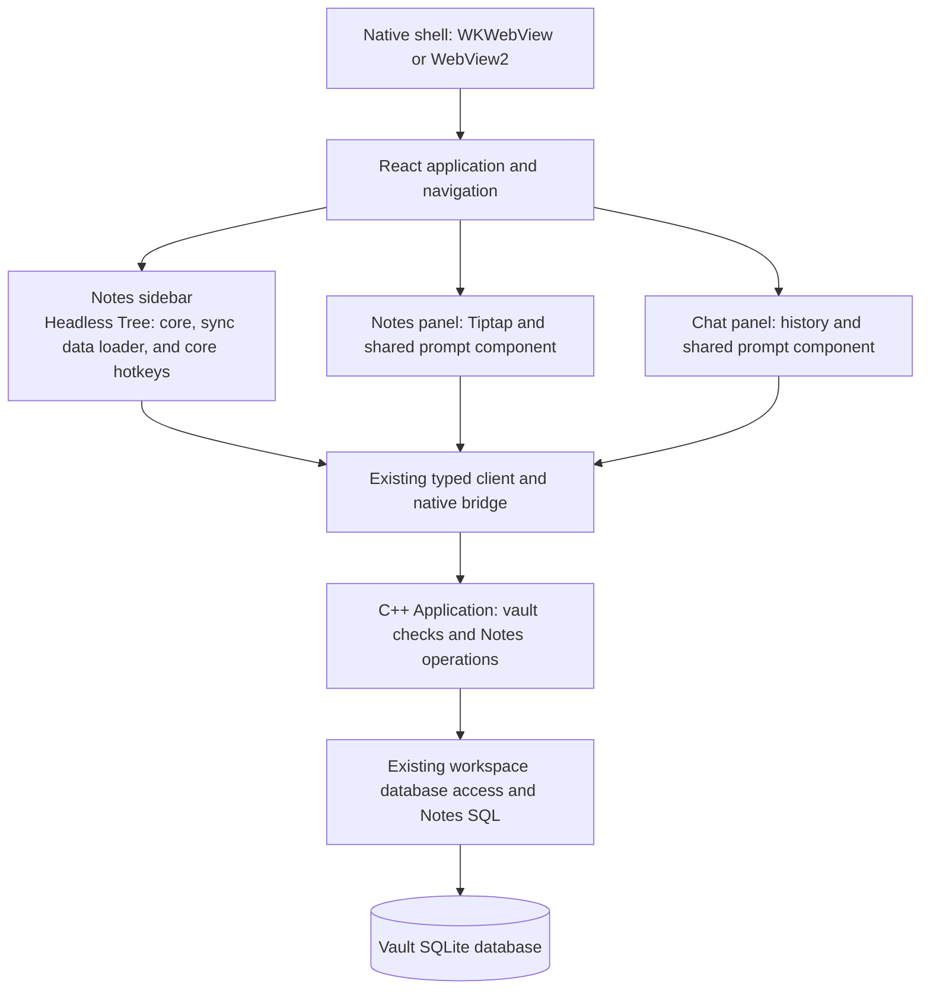

# Notes: high-level architecture

Status: proposed architecture for the first desktop version. Based on
[notes-prd.md](notes-prd.md). The PRD defines user behavior; this document
defines component boundaries, data ownership, and technical choices. It does
not approve a screen design or indicate that Notes has been implemented.

## 1. Architecture and scope

Keep the existing native shells and bundled React application. macOS uses
WKWebView; Windows uses WebView2. Both run the same Notes frontend and call
the existing C++ application through the native bridge. Notes does not need
a web server, cloud editor service, or separate database.



Chat and Notes remain separate main panels. The shared prompt component is
used by each panel with its own draft and submission handler. A note is not
a session, a transcript entry, or a configuration file. The browser-only
ChaWeb application does not gain a Notes editor.

## 2. Component choices

| Area | Choice | Reason |
| --- | --- | --- |
| Rich-text editing | Tiptap 3 with its React integration and ProseMirror document model | Structured JSON, editing transactions, selection handling, and Undo/Redo. |
| Editor extensions | StarterKit configured to the supported features, plus single-color Highlight and Image; register Link and Underline only once | Keep the schema within the PRD instead of enabling every demo feature. |
| Find and replace | Headless `@tiptap/extension-find-and-replace` | Use the supplied search engine independently of the controls. |
| Folder tree | Headless Tree: core, sync data loader, and core hotkeys | Supplies tree interaction and keyboard navigation while CHA renders the rows. |
| Prompt entry | Extract the existing prompt entry behavior from `ChatScreen` into a shared component and small hooks as needed | Reuse voice input, transliteration, resizing, and submission handling. |
| Persistence | Tiptap JSON in the existing vault database | One durable document representation; whole-vault transfers include the content. |
| Pictures | Base64 data URLs inside Image nodes in the saved JSON | Meets the agreed offline and vault-transfer behavior without another file store. |
| Styling | CHA's bundled styles and approved controls | No dependency on a remote stylesheet or a particular Tiptap demo layout. |

Tiptap's React package and the selected search extension are MIT-licensed.
Headless Tree is also MIT-licensed. Keep the required license and copyright
notices with the distributed dependencies. Hosted collaboration and other
paid Tiptap services are not required by this architecture.
Sources: [Tiptap React package](https://github.com/ueberdosis/tiptap/blob/main/packages/react/package.json),
[search package](https://github.com/ueberdosis/tiptap/blob/main/packages/extension-find-and-replace/package.json),
[Tiptap license](https://github.com/ueberdosis/tiptap/blob/main/LICENSE.md),
[Headless Tree license](https://github.com/lukasbach/headless-tree/blob/main/LICENSE).

Pin exact tested package versions and commit the npm lockfile. Select matching
Tiptap package versions together. Verify React 19 and both embedded browsers
before accepting those pins; an upstream `main` version is not a tested CHA
version. Package installation is implementation work, not part of this document.

The supplied Tiptap toolbar/template and Search and Replace panel remain UI
candidates. Compare them with small CHA controls during screen design. If
source is copied from a template, record its upstream version or revision and
treat it as maintained application code. Do not run a UI generator before
the proposed visual changes have approval.

## 3. Frontend ownership and integration

Extend the existing `App` view state with the selected sidebar tab and
active note identity. Switching sidebar tabs changes the browsing view only.
Opening a note selects the Notes main panel; opening a session selects Chat
after the current note passes the save-before-leaving rule.

Headless Tree's focused item is the target for tree actions. App's active
note identity identifies the open document and the destination of Notes
prompt input. Moving tree focus with arrow keys does not open another note
or change that destination; opening a note is a separate activation action.
Do not add a second selected-tree-item state or derive the open note from
tree focus.

| State | Owner and lifetime |
| --- | --- |
| Tree metadata | Notes sidebar, scoped to the current vault context. Contains IDs, parents, kinds, and names, not document bodies. |
| Active document and editing history | One Tiptap instance for the open note. The editor document is the authoritative in-memory content. |
| Cursor and selection | Tiptap/ProseMirror selection state, including the remembered insertion position while the prompt has focus. |
| Save progress | Small state associated with the active editor: edit and saved serials, the one in-flight save, deadline, due flag, and error. |
| Chat and Notes prompt drafts | App keeps one Chat draft with its conversation key and one separate Notes-panel draft above the screen components. |
| Tree focus and expanded folders | Local state owned by the Headless Tree instance for the current vault. Creation expands the destination path and focuses the new item. Do not add a separate selection store or persistent UI preferences. |

Do not copy the editor JSON into global React state after each keystroke.
Read a snapshot when saving or performing a content operation. Do not retain
an editor instance or document cache for every note. Closing and reopening a
note reloads its saved document; old Undo history is not required.

App keeps one Chat draft together with the existing conversation key: vault,
forum, and session. Restore that draft only when the user returns to the same
conversation. Opening another conversation replaces the Chat slot with an
empty draft for that conversation, so text cannot move to a different session.
The Notes draft has one separate slot and stays with the Notes panel across
panel and note switches. Do not add a draft database or collections of
per-conversation or per-note drafts. Persistence across an application restart
is not part of the requirement.

The shared prompt accepts a submission callback. Chat supplies its existing
session submission path. Notes supplies a local editor insertion command.
Notes never passes text through the chat command parser or target selection.
Its ability to accept input depends on the open note and voice configuration,
not on an active chat session or model generation. Reuse existing voice
cleanup and stale-callback checks when a panel closes.

## 4. Editor schema and commands

Store and load a Tiptap JSON document with a fixed supported schema:
paragraphs, text, hard breaks, headings, supported lists and list items,
pictures, and the agreed formatting/link marks. Disable unused StarterKit
features such as inline code, code blocks, blockquotes, strike-through, and
horizontal rules for this version. Font color, tables, and arbitrary HTML
are outside the schema.

Use JSON to initialize the editor and `getJSON()` to obtain save content.
HTML is a clipboard/rendering format, not a second stored document. Set
`enableContentCheck: true` and register `onContentError` when initializing
Tiptap. Use its registered extensions as the schema; do not add a separate
custom schema validator.

Treat `contentError` or an initialization exception as a failed note opening.
Show an opening error, leave the stored document intact, and allow no editing,
document commands, or saving for that failed load. Start automatic saving
only after successful initialization. Never save fallback or stripped content
after a content error; reporting the error alone does not prevent that.
[Tiptap content checking](https://tiptap.dev/docs/guides/invalid-schema)

Keep document-changing actions as editor commands. Toolbar controls, keyboard
shortcuts, and CHA code call the same commands. There is no need to simulate
button clicks or send rich-text editing operations to C++.

Each complete command must form one Undo step, separate from adjacent typing.
Use ProseMirror transactions and history boundaries; Replace All must not be
implemented as a loop of separately dispatched replacements. Automatic saves
read the editor state and do not replace its content or reset history.
[ProseMirror history implementation](https://github.com/ProseMirror/prosemirror-history/blob/master/src/history.ts)

### Prompt insertion

Build paragraph content from text nodes and hard breaks, without parsing
Markdown or HTML or inheriting marks at the insertion point. Apply the exact
paragraph, heading, list-item, boundary, and selection rules in PRD section
4.6. In particular, insertion inside a list item stays inside that item.

Initialize the insertion point at the end when a note opens. Use editor
positions and selection mapping rather than a DOM cursor range that becomes
invalid when focus changes. After insertion, put the cursor at the end of the
new paragraph, before any trailing original content; the end-of-block rule
then puts the next paragraph after it. ProseMirror cannot place a cursor
between two text blocks, so do not add a custom selection type. Keep keyboard
focus in the prompt. New HTTP/HTTPS URLs follow the same link rules as other
input.

Clear submitted prompt text only after the complete editor transaction is
accepted. Preserve text entered during submission, using the current prompt
behavior. A library command returning `true` is not sufficient if a transaction
guard rejected the change. Undo restores replaced content and the previous
block structure; it does not restore the cleared prompt draft.

### Search and replacement

Use the headless extension for matches, navigation, and replacement. Follow
PRD section 4.5: Match case in both modes, Whole word unavailable in regex
mode, literal replacement text, empty replacement for deletion, and one Undo
for the whole command. Do not inherit the supplied panel's restriction on
empty replacement. Use bundled CHA styles for match decorations.
[Extension documentation](https://tiptap.dev/docs/editor/extensions/functionality/find-and-replace)

Search state and match decorations are transient; they are not saved in note
JSON. Controls must target the note editor without taking over unrelated
prompt shortcuts. Search across all notes and a second search index are not
part of this design.

### Clipboard, pictures, and validation

Use ProseMirror's schema-based clipboard parsing to retain supported nodes,
marks, and attributes and omit unsupported formatting such as font color.
Do not add DOMPurify to the editor paste path or reuse the Markdown renderer's
sanitizer. Parse clipboard HTML in a detached document; never insert raw
clipboard HTML directly into the live editor DOM.

Use ProseMirror's paste hooks in their normal order:

1. In `transformPastedHTML`, flatten tables into text in reading order, with
   readable separators between cells and rows. Remove pictures whose source
   is not a `data:` URL. Return the changed HTML string for ProseMirror to
   parse through the schema. Preserve unaffected markup and `data-pm-slice`
   metadata so copying within a note keeps its structure.
2. In `handlePaste`, examine the parsed slice. Use the shared picture checks
   to validate the actual type and decoded byte size of every picture. If a
   check fails, show the error and return `true` without inserting anything.
   If the slice is empty and the clipboard has an image file, start the shared
   import path described below and return `true` immediately. In all other
   cases, return `false` so ProseMirror inserts the slice. The transaction
   guard described below checks the resulting complete document size.

Do not read and parse clipboard HTML again in `handlePaste` or replace
ProseMirror's normal slice insertion and plain-text fallback. Keep the
HTTP/HTTPS link policy in the Link extension configuration described below.
[ProseMirror clipboard parsing](https://github.com/ProseMirror/prosemirror-view/blob/master/src/clipboard.ts)
and [paste handling](https://github.com/ProseMirror/prosemirror-view/blob/master/src/input.ts).

Local image files and clipboard images go through one checked import path.
Use PNG, JPEG, WebP, and GIF only. Validate the actual image representation and
raw byte size before encoding. Use Image nodes with `allowBase64: true` and
store the resulting data URL. The Image extension renders pictures; CHA owns
import, validation, and persistence.
[Image extension](https://tiptap.dev/docs/editor/extensions/nodes/image)

Reject an oversized mixed paste as a whole. Do not fetch remote image URLs
or persist temporary file/blob references. Async imports must finish their
validation and encoding before insertion and remain bound to the originating
note/editor and vault context; a late result cannot insert into another note.

Enforce 1 MiB per decoded picture and 12 MiB for the UTF-8 bytes of the complete
document JSON. In the frontend, measure
`new TextEncoder().encode(JSON.stringify(document)).byteLength`, including
Base64 image data and JSON escaping. Exclude the bridge request envelope;
the editor does not need request IDs, method names, connection IDs, or epochs
to check an edit. The bridge's separate 16 MiB request limit leaves room for
that envelope and remains unchanged.

Check the proposed complete document before accepting each content change.
Use a transaction guard as a final check for typing, commands, Undo/Redo, and
paste. Rejection leaves content, selection, and history unchanged. Do not
apply a partial change and then repair it with Undo. Picture and link policies
belong to the frontend; document structure follows Tiptap's schema.

For document content, the C++ core checks only that it is a JSON object and
that its UTF-8 serialized size is at most 12 MiB (12,582,912 bytes) before
storing it. Treat the document as opaque JSON: the core does not inspect
Tiptap nodes, marks, attributes, or URLs, or decode Base64 pictures. This
is the same document-only limit used by the frontend. Item, hierarchy, and
vault checks remain core responsibilities as described below.

Start with straightforward size measurement and profile a note near 12 MiB.
Avoid re-encoding unchanged pictures. Add cached byte counts or another
optimization only if measurement shows it is needed to keep typing responsive.
Whole-document saves and embedded images are an accepted first-version cost.

### Links

Apply an explicit HTTP/HTTPS allowlist when importing, autolinking, editing,
and loading links. Configure bare domains to use HTTP as agreed. Unsupported
schemes keep their text and cannot become active links. Image data URLs are
permitted only as picture content, not as hyperlink destinations.

Use the existing native navigation interception to open links in the default
browser. Extend both shells' current HTTPS-only checks to accept HTTP too;
keep other schemes blocked. An ordinary click opens the link, while secondary
click and keyboard actions provide Edit link and Remove link. Unlinking must
survive save/reopen and must not immediately trigger autolinking again.

Keep styles and scripts bundled with CHA. Existing native image policies
already allow data URLs; Notes does not require opening the content security
policy to remote image hosts or arbitrary embedded content.

Keep the packaged hosts' `style-src 'self'` policy. Set Tiptap's
`injectCSS: false` and include the required ProseMirror and Tiptap base CSS
from the pinned versions in CHA's bundled stylesheet, including rules that
preserve whitespace. Do not rely on injected `<style>` blocks or inline
`style` attributes. Configure Highlight with `multicolor: false` and define
one highlight color in the bundled CSS; normalize supported pasted highlights
to that mark. This is the first-version choice, not a CSP restriction to one
color. Test the editor early in packaged macOS and Windows builds under the
actual CSP; `npm run dev` alone does not verify this behavior.
[Tiptap CSS injection setting](https://tiptap.dev/docs/editor/api/editor#injectcss),
[Highlight configuration](https://tiptap.dev/docs/editor/extensions/marks/highlight#multicolor)

## 5. Tree and persistent data

Use one new table, provisionally `note_items`, in the vault's existing database:

| Field | Meaning |
| --- | --- |
| `id` | `INTEGER PRIMARY KEY AUTOINCREMENT`; stable ID allocated by SQLite, independent of the name or location. |
| `parent_id` | `INTEGER REFERENCES note_items(id) ON DELETE CASCADE`; null means the top level. |
| `kind` | Folder or note. |
| `name` | `TEXT NOT NULL`; user-visible label with the default BINARY collation. |
| `content_json` | Tiptap JSON for a note; null for a folder. |

The tree query selects metadata only. Load one document body when its note
opens. Rename and move update metadata without rewriting the document or
pictures. Saves update an existing note row; they never create missing notes.
Let SQLite allocate positive IDs on insertion. `AUTOINCREMENT` prevents reuse
of deleted committed IDs; zero is reserved for the root comparison below and
is not a stored item ID.

Enforce sibling-name uniqueness across both kinds with one expression index:

```sql
CREATE UNIQUE INDEX IF NOT EXISTS note_items_sibling_name
    ON note_items(IFNULL(parent_id, 0), name);
```

`IFNULL(parent_id, 0)` includes top-level items in the uniqueness rule while
their stored parent remains null. The default BINARY collation keeps name
comparison exact and case-sensitive. Validate names using the session-label
rules, with Notes-specific error wording. Reject nonexistent parents,
non-folder parents, duplicate destinations, and moves into the item itself
or its descendants. Perform validation and the resulting mutation in one
database transaction.

Delete an item with one `DELETE` of its row in that transaction. For a folder,
`ON DELETE CASCADE` removes its descendants atomically; no custom recursive
deletion is needed. The existing SQLite connection setup already enables
`PRAGMA foreign_keys = ON`. The approved rule deletes a folder with all its
contents after a confirmation that states this scope.
[SQLite AUTOINCREMENT](https://www.sqlite.org/autoinc.html),
[expression indexes](https://www.sqlite.org/expridx.html),
[foreign-key actions](https://www.sqlite.org/foreignkeys.html#fk_actions)

Use `@headless-tree/core` with `@headless-tree/react`, importing only
`syncDataLoaderFeature` and `hotkeysCoreFeature` alongside the built-in core.
The synchronous data loader reads the metadata listing through `getItem` and
`getChildren`. Identify folders by their kind so empty folders remain folders.
After each metadata refresh, CHA updates the listing and calls
`tree.scheduleRebuildTree()` so the next render uses the new data. Render CHA
rows and route changes through CHA core operations; the tree must not become
a second authority for saved names or hierarchy.
[Headless Tree sync data loader](https://headless-tree.lukasbach.com/features/sync-dataloader/),
[refreshing React state](https://headless-tree.lukasbach.com/recipe/external-state-updates/#managing-tree-data-in-a-react-state)

Resolve tree actions from the focused item when the user invokes them:

- Rename, Move, and Delete act on that item's ID. Without a focused item,
  these actions are unavailable. Move keeps that source ID while the user
  chooses a destination folder or the top level.
- Create uses the focused folder as its destination, or the parent of a
  focused note. With no focused item, use the top level. The approved
  destination controls must also let the user choose the top level explicitly.
- A row-specific action first makes its row the focused item. Keep the
  resolved item or destination ID for the operation while its controls have
  keyboard focus; do not retarget it to the open note.

Use the built-in focus state without `selectionFeature`.
[Headless Tree focus without selection](https://headless-tree.lukasbach.com/features/selection/)

After creating a note or folder, refresh the metadata and expand its
destination folder and every ancestor through the tree's expansion state.
Once the new row is rendered, focus it and scroll it into view. Use the tree's
focus methods (`item.setFocused()` and `tree.updateDomFocus()`) rather than
another stored selection. A new note also opens through App's normal note
opening path; creating a folder does not change the open note.

Spread `tree.getContainerProps()` and `item.getProps()` onto the corresponding
CHA elements, preserving their handlers, refs, and accessibility attributes.
Verify the rendered tree with the pinned package version; do not assume that
custom row markup preserves keyboard behavior or ARIA attributes.
[Headless Tree core focus, expansion, and element props](https://headless-tree.lukasbach.com/features/tree/)

Sort folders first, then notes, alphabetically within each parent. Reuse the
frontend's `localeCompare` convention, with an exact-name tie break when it
reports equality. Name uniqueness remains exact and case-sensitive, independent
of display sorting. Do not store manual order.
Use the approved move controls. Refresh the small
metadata listing after a successful mutation; no event stream is needed.

### Database integration and compatibility

Reuse `WorkspaceConfigStore`'s existing database ownership, locking, password,
and maintenance lifecycle. Add small Notes storage functions using the
existing SQLite statement and transaction wrappers. Keep their SQL in a
Notes-specific storage file rather than embedding it in the bridge. Do not
create another long-lived database connection or independent vault manager.

Follow the repository's existing additive schema-2 approach. Use
`CREATE TABLE IF NOT EXISTS` for the Notes table, as the existing
`create_entry_audio_table` function does, and `CREATE INDEX IF NOT EXISTS`
for its indexes. Run these statements atomically through a shared creation
function when creating or opening a vault and when reopening after
maintenance. An older vault with no Notes table starts with an empty
collection. Keep the existing schema-1 import requirement.

Retain the existing database identity and integrity checks and ordinary SQL
error reporting. Do not add a Notes-specific table-shape validator or scan
note documents during vault inspection and transfer. Full vault copies and
R2 transfers must preserve the Notes table; configuration-only paths must
not interpret Notes rows as configuration. Compatibility tests must cover
plain and password-protected vaults.

## 6. Core and native bridge contract

Add Notes methods to the existing typed client, native method registry,
application API, and storage access. Extend `resources/dto.yaml` and regenerate
the existing TypeScript DTO definitions rather than hand-editing generated
types. Notes does not require HTTP routes in ChaWeb or a new bridge protocol.

The method groups are small; names below are provisional:

| Operation | Input and result |
| --- | --- |
| List items | Return the active vault's tree metadata. |
| Create item | Parent, kind, and name; return the created item's metadata. A new note starts with an empty valid document. |
| Load note | Note ID; return its document object. Missing notes, invalid JSON, and non-object content produce errors. Tiptap checks the editor schema in the frontend. |
| Save note | Note ID and complete document object; acknowledge only after the transaction commits. |
| Rename or move item | Item ID and new name or parent; return committed metadata. |
| Delete item | Item ID; delete the item and all its descendants atomically after the approved confirmation. |

Every operation uses the existing connection identity and `context_epoch`.
The application checks admission under its existing lifecycle lock before
accessing the active database. Notes mutations do not change the vault epoch.
The bridge is an adapter. Core validation covers the document object and size,
item metadata, hierarchy, and vault access; storage ownership remains below
the bridge. Editor-schema and picture/link checks remain in the frontend.

Use the normal ordered bridge request path for Notes writes. Retain its queue
limits and error reporting. The ordinary limit of 16 in-flight requests covers
all ordinary requests of the connection. Exceeding it invalidates the
connection, and the page reloads, so Notes must stay far below it. There is no
custom save worker, persistent outbox, document patch protocol, or
collaborative conflict-resolution service.

## 7. Automatic saving and navigation

Track a local edit serial on accepted document changes. A save captures the
document and that serial; a successful reply acknowledges only that snapshot.
Later edits remain unsaved. These serials are transient frontend bookkeeping,
not database revisions or another stored copy of the document.

Start one deadline on the first change not covered by the most recent save
submission. Further typing does not reset it. Submit the current full document
within five seconds. Changes made after that snapshot start the next deadline.
Keep at most one Notes save request in flight. If a deadline expires while an
earlier save has no reply, mark the save as due and submit the current
document as soon as that reply arrives. The bridge runs ordinary requests in
order, so a second queued save could not start earlier anyway. Waiting for the
reply does not make the database write later; it keeps superseded snapshots
out of the bridge queue. Do not build a separate queue of document snapshots
in application state.

On failure, keep the latest editor content and show the persistent actionable
error defined by the PRD. Retry uses the current document. A retry starting
does not clear the error. Do not add a retry loop or another periodic timer.
Successful saving of the affected changes, explicit discard, or successful
confirmed deletion resolves the error.

Provide one save-before-leaving path at the application navigation boundary.
Keep the editor mounted while it resolves. Prevent new document changes
during the final flush, wait for the in-flight save, and save any remaining
changes before completing navigation. On failure, use Retry / Stay / Discard;
restore editing when the user stays. Discard closes the editor after the
in-flight save settles, then completes navigation.
Cancel the editor's pending deadline before disposing it. Ignoring a Promise
does not cancel an already admitted database write; the in-flight save must
be settled before the old editing context is released.

Use this path for another note, a chat session, Settings, other screens that
close the editor, and vault switching. Settings closes the editor; its vault
operation buttons need no additional Notes save procedure. Merely switching
sidebar tabs or moving focus does not close the editor or force a save.
Integrate with `App` and the existing `useLiveSession` navigation entry points.
Resolve the note before starting a session-open/create or vault-switch
operation, not only before dispatching the final screen change.

Automatic reloads in `webapp/src/api/nativeRecovery.ts` after
`app.connectionInvalidated`, `receiver-error`, or recovery-triggering
`app.contextChanged` events are fault recovery under the PRD's crash exception:
they can lose unsaved edits and are outside the save-before-leaving guarantee;
do not add save hooks or recovery machinery for these paths.

Deletion is the PRD's exception. For the open note or an approved folder
deletion that contains it, cancel the scheduled autosave, settle prior writes,
and perform deletion without saving the unsaved remainder. Keep the editor
content until deletion succeeds. Failure or cancellation leaves it available;
success closes it and discards the changes. A late save cannot recreate a
row, and a deleted item has no recovery action in CHA.

## 8. Native close handshake

Both current shells start runtime shutdown directly. Add a small host/page
handshake before that step; `beforeunload` cannot reliably finish an async
SQLite save. Reuse the existing trusted native message channel. The page owns
the same Retry / Stay / Discard dialog for navigation and application close.
Each native shell supplies only the Cancel close / Close anyway fallback for
a page that does not reply.

1. The native shell stops the close and keeps the window, runtime, and bridge
   connection alive. It sends one `prepare-close` request with a new attempt
   ID and starts a bounded response timer.
2. The page runs the same final save operation used by navigation. Once there
   are no unsaved changes and no in-flight save, it replies `ready` with that
   attempt ID. If no work is pending, it replies immediately. The native shell
   stops the timer and starts the existing runtime shutdown.
3. If saving fails, the page immediately replies `cancelled` with the attempt
   ID, then shows the shared frontend Retry / Stay / Discard dialog. The native
   shell ends the attempt, stops the timer, and takes no further close action.
   Retry saves through the frontend; another failure keeps the same dialog
   available. Stay clears the pending close intent and restores editing.
4. After a successful Retry or an explicit Discard, the page resolves its
   unsaved state and pending writes, then sends `close` as a new close request.
   Keep document changes blocked during this handoff. The native shell starts
   a new attempt through its normal close entry point, with a new ID; the page
   now replies `ready` immediately. The page never bypasses the handshake.
5. If the response timer expires, stop it and stop accepting replies for that
   attempt before showing native Cancel close / Close anyway. This dialog must
   work with a hung renderer. Cancel close keeps CHA open; Close anyway starts
   the existing runtime shutdown and may lose unsaved edits. Never close just
   because the wait expired, and run no close timer while the user decides.

Accept `ready` and `cancelled` only for the current waiting attempt. Ignore
late replies after cancellation, expiry, or the start of another attempt.
On expiry or a native Cancel close choice, notify the page so it can release
that attempt's pending close intent and restore editing when responsive; a
late save completion must not request another close. A page `cancelled` reply
on save failure ends the native attempt but preserves the page's pending
decision for Retry / Stay / Discard. Keep at most one native wait and one
frontend save dialog active. If another prepare-close request
arrives while that dialog is open, the page replies `cancelled` and keeps the
existing dialog instead of starting another save or prompt.

Before implementing the rest of the macOS handshake, test page communication
in a packaged macOS build while `applicationShouldTerminate` has returned
`.terminateLater`. AppKit runs in `NSModalPanelRunLoopMode` until the app
replies. The existing shutdown uses `DispatchQueue.main` in this state, but
detaches the bridge first; it does not establish that WebKit messages work.
Keep the runtime and bridge alive during this test.
Verify page-to-shell script messages, shell-to-page `callAsyncJavaScript`,
and a complete page/core request and reply through the existing bridge
delivery path. The exchange must complete while termination is still pending,
not only after replying to AppKit. Also verify that the response timer fires
when the page withholds its reply, and that cancelling termination restores
normal interaction. Record the macOS/WebKit versions and results.
[AppKit termination modes](https://developer.apple.com/documentation/appkit/nsapplication/terminate(_:))

On macOS, assign an `NSWindowDelegate` and have `windowShouldClose` call
`NSApp.terminate` and return `false`, keeping the window visible. Use
`applicationShouldTerminate` as the single entry point for Quit, window close,
and page `close` requests. Choose the implementation from the test result:

- If the test passes, run the handshake with `.terminateLater`. A page
  `cancelled` reply or native Cancel close choice completes that pending
  termination with `NSApp.reply(toApplicationShouldTerminate: false)`.
  After `ready` or Close anyway, run the existing runtime shutdown and reply
  `true` when it finishes.
- If the test fails, return `.terminateCancel` and start the same handshake
  after returning to the normal main run loop. Keep the window, runtime, and
  bridge alive. Repeated Quit requests during the wait return `.terminateCancel`
  without starting another attempt. Once `ready` or Close anyway permits
  shutdown, set a one-use flag and call `NSApp.terminate` again. The next
  `applicationShouldTerminate` consumes the flag, skips only the page
  handshake, and runs the existing asynchronous runtime shutdown with
  `.terminateLater`, replying `true` when it finishes. A cancelled handshake
  leaves the flag clear; no AppKit termination reply is needed because the
  original request was already cancelled.

Both choices keep the attempt IDs, frontend Retry / Stay / Discard flow,
timeout choice, and shutdown deadline described here. Select one path during
implementation; do not add automatic runtime switching between the two.
[AppKit termination reply](https://developer.apple.com/documentation/appkit/nsapplication/reply(toapplicationshouldterminate:))

On Windows, keep `request_close()` as the entry point for Exit, window close,
and page `close` requests. It runs the handshake; call `begin_shutdown()` only
after `ready` or Close anyway. A `cancelled` reply only ends the wait. The
fatal-error path and the smoke test go to `begin_shutdown()` without the
handshake. On macOS, the existing fatal-error path already skips it.

Do not set existing shutdown flags early if they prevent the final bridge save
from running. The existing ten-second shutdown deadline starts only when the
handshake permits shutdown, not while saving or choosing how to proceed.
The response-wait duration and dialog presentation remain detailed design
choices; the PRD's no-silent-discard behavior is fixed.

## 9. Vault operations

Notes uses the existing whole-database transfer paths. Full Copy, Upload,
and Download include the Notes table and embedded pictures. Verify that
protected-vault copy and protection changes preserve these rows too.

Merge and Parent merge continue to copy configuration only. Workspace Export,
Workspace Import, and the Markdown session mirror exclude Notes. Import
does not erase the destination's Notes table. A new vault without a copy
source starts with an empty collection.

Download replaces the local collection and retains the previous database in
the existing single `.bac` backup, under PRD section 5.1. Keep its confirmation
explicit about note replacement. Parent merge retains its existing preliminary
parent-vault Download semantics, even though its UI is in ChaWeb. Do not add
a Notes merge algorithm or item-level restore feature.

The frontend navigation rule prevents normal saves from surviving a vault
transition. Core epoch checks and the existing maintenance lock remain the
final protection against a stale request writing into a different or replaced
database. Async loads, imports, and replies also check their original editor
and context before changing frontend state.

## 10. Main integration points and verification

| Existing area | Expected change |
| --- | --- |
| `webapp/src/components/App.tsx`, `webapp/src/state/view.ts`, `webapp/src/useLiveSession.ts`, and `webapp/src/components/Sidebar.tsx` | Notes navigation, Headless Tree integration, separate drafts, and save-before-leaving integration. |
| `webapp/src/components/ChatScreen.tsx` | Extract shared prompt entry without changing chat command behavior. |
| New Notes frontend files | Editor configuration, command integration, paste/size checks, and save state. |
| `webapp/src/api/client.ts`, `webapp/src/api/nativeClient.ts`, `webapp/src/api/nativeBridge.ts`, and `resources/dto.yaml` | Typed Notes calls, guards, and the host close handshake. |
| `src/bridge/` and `src/app/` | Notes dispatch and application operations under existing vault admission rules. |
| `src/storage/` and `src/workspace/workspace_config_store.*` | Notes table creation, SQL operations, document object/size checks, item/hierarchy checks, and existing connection access. |
| `packaging/macos/main.swift`, `packaging/macos/native_bridge.swift`, and `packaging/windows/main.cpp` | Save-before-close handling and HTTP/HTTPS browser opening. |

Use focused checks at these boundaries:

- First macOS close check: run the packaged-app test in section 8 before the
  rest of the handshake work. Confirm page messages, JavaScript calls, bridge
  replies, timeout delivery, and cancellation during pending termination;
  use the normal-run-loop fallback if the test fails.
- Storage tests: older vault opening, document object/size limits, deleted-ID
  non-reuse, root/sibling name uniqueness, atomic cascading deletion, tree
  invariants, update-only saves, and preservation through relevant vault operations.
- Tree integration test: Up/Down move focus between visible rows; Left/Right
  collapse/expand folders or move to their parent/first child. Moving focus
  leaves the open note unchanged; subsequent tree actions use the focused row.
  Check `role="treeitem"`, correct one-based `aria-level`, and `aria-expanded`
  matching each folder's state and absent on notes. Creating an item under
  collapsed ancestors reveals and focuses its row.
- Editor tests: content-check failures leave stored notes unchanged and prevent
  editing/saving; every PRD insertion case, one-step Undo/Redo, empty replacement,
  literal regex replacement, filtered paste, unlinking, and rejected changes.
- Paste checks: internal copy/paste keeps structure, tables keep readable text,
  plain-text fallback works, invalid pictures reject the whole paste, and
  clipboard image files use the import path without duplicate insertion.
- Save tests: continuous typing, edits while a save is in flight, a due save
  sent after the reply, never more than one Notes save request in flight,
  failures/retry, navigation, discard, deletion, and stale vault requests.
- Draft checks: restore the Chat draft only for the same vault/forum/session;
  keep the single Notes draft separate across panel and note switches.
- Native tests on both platforms: clipboard behavior, input/IME, voice prompt
  reuse, HTTP/HTTPS opening, normal close, frontend Retry / Stay / Discard,
  repeated close requests, hung-page choices, and ignored late attempt replies.
- Early packaged-build checks on both platforms: whitespace preservation,
  editor layout, and highlighting under the actual CSP, with no blocked
  editor styles.
- Performance checks with a note near 12 MiB: typing, size validation, search,
  repeated full-document saves, and reopening.

Other early implementation checks should confirm the pinned editor/tree
packages, the PRD's block-splitting and Undo behavior, and large-note
responsiveness.
These are integration risks, not reasons to add speculative infrastructure.
Run existing frontend, bridge, storage, and native checks appropriate to each
change, with PRD section 8 as the acceptance reference.

## 11. Decisions left for detailed design

The remaining product/UI decisions stay those in PRD section 7: Notes panel
layout, organization and nonempty-folder deletion controls, picture controls,
and supplied versus CHA find controls. Present visual designs for approval
before implementing them. Do not add panel title legends or explanatory text
that merely describes obvious controls.

Detailed implementation will settle exact dependency pins, DTO/method names,
SQL declarations, and the native response wait. It must keep the selected
boundaries and PRD behavior. If a component cannot meet a required behavior,
report that finding before changing the PRD.
