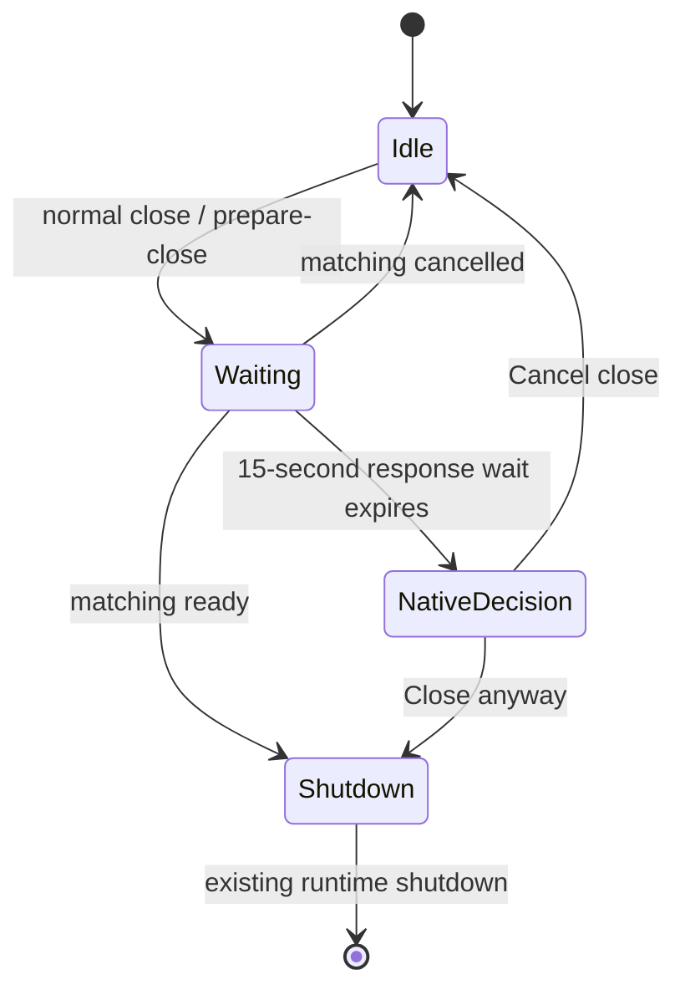

# Notes: detailed design

Status: reviewed technical guidance; implementation and verification remain
pending.
Prepared on 2026-10-11 from [the PRD](notes-prd.md),
[the high-level architecture](notes-arch.md), and the current repository.

The PRD defines required behavior. The architecture defines the implementation
boundaries. This document makes those boundaries concrete and records the
remaining verification work. Proposed UI layouts and copy below require
explicit visual approval before implementation, under [AGENTS.md](../AGENTS.md).
Approval of this document's technical design does not by itself approve its UI.

## 1. Decisions and scope

The user confirmed these decisions while this document was prepared:

| Decision | Result |
| --- | --- |
| Delete a nonempty folder | Delete the folder and all its descendants after a confirmation that states this scope. Cancel leaves all content unchanged. |
| Notes prompt on vault switch | Clear its draft only after a successful switch. A failed or canceled switch retains it. Returning to the old vault does not restore an older draft. |
| Formatting toolbar | Use the visually reviewed **Direct tools** layout, with formatting actions exposed in the toolbar. |
| Prompt appearance | Preserve the existing CHA composer and its key control buttons, as shown in the user's screenshot. Remove forum, persona, active-character, and message-target information in Notes. Do not redesign this part of the UI. |
| Chat-only prompt controls | Hide the automatic-audio speaker button and session-picture toggle in Notes. Keep microphone, Send, and transliteration in their existing positions. |
| Continuous dictation | Use the existing microphone button to keep filling the Notes draft while the user speaks. Preserve spoken submission that inserts into the current note and keeps listening; no additional mode button is needed. |

The first version uses one open Tiptap document, one metadata tree, and one
new table in the active vault database. There is one Chat prompt draft and
one Notes prompt draft. Use the existing native bridge, database ownership,
vault maintenance, voice input, and transliteration paths.

The following are design selections, subject to the verification gates in
section 15:

| Area | Selection |
| --- | --- |
| Find controls | A small CHA find bar backed by Tiptap's headless extension. |
| Organization | Create and move dialogs with an explicit parent selector; row menus for Rename, Move, and Delete. |
| Pictures | One-file input plus clipboard import; embedded data URLs; no upload service. |
| Native close response wait | 15 seconds per native attempt, followed by a native decision dialog. No automatic close on expiry. |
| Note IDs on the bridge | Positive JavaScript-safe integers; `null` for a root parent. |
| Schema evolution | Additive schema-2 table creation; no Notes schema version or document migration subsystem. |
| Save requests | At most one Notes save request in flight (section 10). |

No Notes content enters chat context. No Notes API is added to ChaWeb. Do not
add document caches, saved drafts, note revisions, an autosave worker, a
picture store, or a Notes event stream. Do not make successful Notes operations
depend on unused configuration; use the existing warning behavior for obsolete
settings.

## 2. Existing code and change boundaries

These are current integration points, not a claim that Notes code exists:

| Existing code | Relevant behavior and planned change |
| --- | --- |
| `webapp/src/components/App.tsx` | Owns screens, navigation, and vault switching. Add Notes navigation, the two draft slots, and the shared leave decision. |
| `webapp/src/state/view.ts` | Add `mainView: 'notes'`, `sidebarTab`, and `activeNoteId`. Preserve the active conversation when displaying Notes. |
| `webapp/src/useLiveSession.ts` | Starts session operations before their final view dispatch. Guard operation entry, including its already-open-session shortcut, before any session side effect. |
| `webapp/src/components/Sidebar.tsx` | Keep Chat browsing; add Notes browsing and reuse existing menu/dialog conventions. |
| `webapp/src/components/ChatScreen.tsx` | Currently owns a draft that disappears on unmount. Extract prompt entry and lift its draft without changing chat commands or generation rules. |
| `webapp/src/components/ConfirmDialog.tsx` | Reuse its native HTML dialog and focus conventions for deletion. Extend only where a distinct three-action save decision needs it. Do not use `window.confirm`. |
| `webapp/src/api/client.ts`, `nativeClient.ts`, `nativeBridge.ts` | Add typed Notes operations and response guards. Preserve connection identity, epoch checks, queue limits, and error handling. |
| `resources/dto.yaml` | Define transport-neutral Notes DTOs; regenerate `webapp/src/api/schema.d.ts`. This file holds only data shapes. |
| `src/bridge/bridge_protocol.cpp` | Register the Notes native method names with the existing methods. `nativeClient.ts` uses the same strings. |
| `src/app/application.*` | Admit each Notes operation under `lifecycle_mutex`, then access the active store. |
| `src/workspace/workspace_config_store.*` | Own the existing database connection and its mutex. Add small forwarding methods for Notes storage operations. |
| `src/storage/workspace_session_database.cpp` | Add shared Notes schema creation to new-database creation; retain database identity and integrity checks. |
| `packaging/macos/main.swift`, `native_bridge.swift` | Add close negotiation while keeping WebKit and the runtime alive; allow HTTP as well as HTTPS browser links. |
| `packaging/windows/main.cpp` | Put close negotiation before `begin_shutdown()`; apply the same link policy. |

Start with these new frontend units; split them only if actual implementation
size makes a split useful:

- `components/PromptInput.tsx`: controlled text entry, voice, transliteration,
  resizing, and submission using the existing composer markup and styles.
  Chat-specific behavior remains in `ChatScreen`.
- `components/NotesScreen.tsx`: editor, formatting/find/link controls, prompt,
  loading state, and errors.
- `components/NotesTree.tsx`: metadata loading, Headless Tree, and item dialogs.
- `notes/editor.ts`: extension configuration, transaction acceptance, prompt
  insertion, and history boundaries.
- `notes/pictures.ts`: shared picture import and validation.
- `notes/useNoteSave.ts`: save serials, deadline, the one in-flight save, and flush.

Put Notes SQL and item structures in `src/storage/note_storage.{h,cpp}`.
Use `src/bridge/notes_dispatch.cpp` as a thin adapter, registered alongside
the existing operation dispatchers. Small Application methods can stay in
`application.cpp`; a separate Notes service or manager is unnecessary.
Add the new C++ source files to the existing CMake target.

## 3. UI design and approval

The sketches specify controls and placement, not a new visual theme. Use CHA's
existing spacing, colors, buttons, dialogs, and focus outlines. The editor and
prompt have no added panel title or legend. `Chat` and `Notes` are sidebar tab
controls. Sample note content in the sketches is not interface copy.
The user approved the Direct tools toolbar in the visual review and specified
reuse of the existing prompt. Preserve its layout, styling, resize behavior,
icons, and control positions, with the Notes-specific omissions below.
Other proposed UI behavior still requires visual approval before implementation.

### 3.1. Main layout

```text
┌─────────────────────────┬────────────────────────────────────────────────┐
│ [Chat] [Notes]          │ [≡] [Paragraph ▾] [B] [I] [U] [Highlight]      │
│ [New note] [New folder] │ [List ▾] [Picture] [Link ▾] [Undo] [Redo]      │
│                         │ [Find]                                         │
│ ▾ Study                 ├────────────────────────────────────────────────┤
│   ▾ Philosophy          │ What I want to study                           │
│     Plan             ⋯  │                                                │
│     Reading          ⋯  │ Read one chapter and write a short response.   │
│ ▸ Work                  │                                                │
│ Journal              ⋯  │                                                │
│                         │                                                │
│                         ├────────────────────────────────────────────────┤
│                         │ Prepare the next paragraph here…               │
│                         │                                                │
│                         │                                (Mic) (↑)     │
│                         │                                      (A→Я)     │
└─────────────────────────┴────────────────────────────────────────────────┘
```

The sample prompt text represents a draft, not placeholder/helper text. Reuse
the existing rounded composer surface. Microphone and the circular up-arrow
Send button stay at the lower right inside it; the existing lower control row
stays beneath it. Preserve enabled, disabled, and active styling, including
the microphone's recording state and the `A→Я` transliteration control.
Hide the automatic-audio speaker and session-picture buttons in Notes. The
speaker controls audio playback of chat responses, not dictation. Pictures
in a note remain available through the editor toolbar and clipboard import.
Remove the forum name, From/To text, character-specific placeholder, and
message-target selector in Notes. Do not add Clear or replace the up-arrow
with a wide labeled button. Put `Send to <note path>` in its accessible name
and keyboard-accessible tooltip, without adding a visible destination label.
The destination remains the open note even when the sidebar shows Chat.

The editor takes the remaining height and scrolls independently. The prompt
starts at the existing composer height and uses its current resize behavior.
Clamp resizing to leave the editor usable. Keep controls available when the
window is short by allowing the Notes container to scroll; do not hide the
prompt, place it over the document, or remove actions to fit the window.

At narrower widths, the existing sidebar toggle controls the sidebar and the
toolbar/find controls wrap in their original order. The prompt remains below
the editor. Do not add a second mobile layout or a split pane with chat history.

```text
┌──────────────────────────────────────┐
│ [≡] [Paragraph ▾] [B] [I] [U]        │
│ [Highlight] [List ▾] [Picture]       │
│ [Link ▾] [Undo] [Redo] [Find]        │
├──────────────────────────────────────┤
│ What I want to study                 │
│                                      │
│ Read one chapter…                    │
├──────────────────────────────────────┤
│ My next paragraph                    │
│                         (Mic) (↑)   │
│                              (A→Я) │
└──────────────────────────────────────┘
```

Mark the open note independently of tree focus, for example with the existing
active-row treatment and `aria-current`. Arrow-key focus can be on another
item. Switching sidebar tabs changes only browsing. Selecting a note by its
primary action opens it; selecting a folder expands or collapses it.

After deleting the open note, keep the Notes panel with no editor and a
`New note` action. Keep the Notes draft, but disable submission until a valid
note opens. An empty Notes tree always exposes New note and New folder.
Do not add empty-state explanatory prose.

### 3.2. Create, rename, move, and delete

Creation uses a name input and destination control. Its initial destination
is the focused folder, the focused note's parent, or the top level. The
destination is editable before confirmation. Use a native `<select>` with
`Top level` followed by full folder paths; duplicate leaf names stay distinct.
Use the same destination control for Move. No drag and drop is required.

```text
┌──────────────────────────────────────┐
│ Name         [Plan                 ] │
│ In           [Study / Philosophy  ▾] │
│                    [Cancel] [Create] │
└──────────────────────────────────────┘

┌──────────────────────────────────────┐
│ Move “Plan” to [Top level          ▾]│
│                      [Cancel] [Move] │
└──────────────────────────────────────┘

┌─────────────────────────────────────────────┐
│ Delete “Study” and all notes and folders    │
│ inside it? This cannot be undone in CHA.    │
│                [Cancel] [Delete folder]     │
└─────────────────────────────────────────────┘
```

Rename has the name input and Cancel/Rename actions. Row menus expose Rename,
Move, and Delete; Shift+F10 or the keyboard menu key opens the same menu for
the focused row. A row-specific button first focuses that row. Dialog state
captures the source ID and initial destination; focus changes cannot retarget
an open dialog. Move excludes the source folder and its descendants from the
selector, and the core validates the same rule independently.

Deletion confirmation names the item and distinguishes a note from a folder
with its contents. Every folder confirmation states that its contents are
deleted too, also for an empty folder. Default focus is Cancel. Confirmation
authorizes deleting the entire captured subtree, including unsaved changes to
its open note. No descendant count API or second confirmation is needed.
Validation errors appear in the dialog; failed operations do not alter the
tree optimistically.

### 3.3. Find and replace

Show this bar between the toolbar and document only when Find is open:

```text
Find     [cat                    ] [Previous] [Next]  2 / 7  [×]
Replace  [                       ] [Replace] [Replace all]
[ ] Match case     [ ] Whole word     [ ] Regular expression
```

An empty replacement is valid. Whole word is disabled in regex mode and
remains false when that mode is turned off; do not keep another hidden option
state. Display `No matches` for a nonempty search with zero results. Disable
replacement/navigation when no applicable match exists. The close control
has an accessible name. Search fields and options have real labels.

| Option | Integration cost | Decision |
| --- | --- | --- |
| Supplied Tiptap panel | Adds `react-hotkeys-hook`, shared hooks/utilities, button/card/input/switch primitives, icons, and a style foundation. Its SCSS needs compilation or conversion. Its documented replacement enablement excludes empty text, Whole word remains available in regex mode, and its default shortcut is page-wide. | Would require imported UI code and behavior changes. |
| CHA bar | Uses existing inputs, buttons, CSS, and scoped key handling plus the already-required headless extension. | Selected proposal; implement only the specified controls. |

This comparison is based on the
[supplied panel's documented dependencies and behavior](https://tiptap.dev/docs/ui-components/components/search-and-replace).
Do not install its CLI or copy its template for this design.

### 3.4. Pictures, links, and errors

Picture opens one file picker accepting PNG, JPEG, WebP, and GIF. Clipboard
paste uses the same validation. Render pictures at their natural size up to
the editor's available width, preserving aspect ratio. Selection and ordinary
Delete/Backspace remove an image. Resizing, cropping, captions, and upload
progress UI are outside this version.

Secondary click on a link opens Edit link / Remove link without opening it.
The toolbar Link menu exposes the same actions when the editor selection is
inside a link. It provides keyboard access without requiring a pointer context
menu. Edit link shows a URL input with Cancel/Apply; errors leave the link
unchanged. Ordinary primary click opens its saved web destination.

Normal saving has no persistent status label. A save failure shows a persistent
error next to the document with Retry; text remains selectable and copyable.
The message identifies the note and gives an actionable failure description.
There is no dismiss action that hides an unresolved save failure.

```text
Could not save “Plan”. Check the vault and try again. [Retry]

┌─────────────────────────────────────────────────────┐
│ Could not save “Plan”.                              │
│ Discard unsaved changes and continue?               │
│                         [Retry] [Stay] [Discard]    │
└─────────────────────────────────────────────────────┘

┌─────────────────────────────────────────────────────┐
│ CHA did not finish preparing to close.              │
│ Closing now may lose unsaved changes.               │
│                       [Cancel close] [Close anyway] │
└─────────────────────────────────────────────────────┘
```

The last dialog is native and must work with a hung renderer. Default focus
is Stay in the page's save dialog and Cancel close in the native dialog.
Escape has those cancel meanings. Error text can be more specific than the
example when a safe public error is available. Opening failure shows an error
and Retry opening, never an editable empty document.

### 3.5. Keyboard and focus rules

| Context | Behavior |
| --- | --- |
| Tree | Up/Down move focus; Left/Right collapse/expand or move to parent/child; Enter activates the row. Focus movement alone never opens a note. |
| Note editor | Standard typing, IME, selection, supported formatting, and Undo/Redo. `Mod` means Command on macOS and Control on Windows. |
| Editor or its toolbar | Mod+F opens/focuses Find. The visible Find button also works when focus is elsewhere. Do not capture the prompt's text-entry shortcuts. |
| Find fields | Enter in Find advances; Shift+Enter goes backward. Enter in Replace replaces one match. Escape closes Find and returns focus to the editor. |
| Prompt | Enter submits, Ctrl+Enter inserts a line break, and the configured voice phrase submits without including the phrase. IME composition Enter does not submit. |
| Dialogs and menus | Follow existing focus containment and restore-focus conventions; all actions are keyboard reachable. |

Toolbar actions use the editor's retained selection after focus changes.
Find navigation follows the chosen extension's editor selection behavior;
once it selects a match, that is also the note's insertion selection. The
prompt does not maintain a second stale selection independent of the editor.

When focus leaves the editor, the browser hides the note's caret and selection
highlight. A prompt submission would then replace or split text that the user
cannot see, for example a match that Find selected. Show the stored selection
with an editor decoration while the editor does not have focus: a thin caret
marker for a collapsed selection, and a muted form of the existing selection
color for selected text or a selected image. The decoration is view-only; it
is not saved, does not change history, and disappears when the editor has
focus again. This marker is a proposed visible change and needs approval.

## 4. Frontend state and lifecycle

### 4.1. Ownership

| State | Owner | Reset point |
| --- | --- | --- |
| `sidebarTab: 'chat' \| 'notes'` | App view state | App startup; no persisted preference. |
| `activeNoteId: NoteId \| null` | App view state | Leaving Notes after resolution, Discard, successful deletion, or vault replacement. |
| Active note content, selection, Undo/Redo | One Tiptap instance | Editor disposal after save/discard/delete is resolved. |
| Metadata listing | Notes tree component kept for the current vault | Vault context replacement. |
| Focused row and expanded IDs | Headless Tree instance | Vault context replacement; not a separate selected-item store. |
| Chat draft `{key, text}` | App | Successful opening of a different conversation or successful vault switch. |
| Notes draft `text` | App | Successful submission/clear or successful vault switch. |
| Save bookkeeping | Active editor's save hook | Editor disposal. |
| Loading request identity | Notes screen | Each open attempt or disposal. |
| File import bookmark and origin | Pending import | Completion, cancellation, or editor disposal. |

The Chat key includes vault identity, forum ID, and session ID. Opening the
same conversation after Notes restores its draft. A different conversation
replaces the one Chat slot with an empty draft; a failed open does not replace
it. Notes has no per-note draft. Hide/unmount prompt entry without clearing
the App draft. A full page reload starts with empty drafts.

Use the existing context epoch plus editor identity to reject stale loads,
picture results, and callbacks. Notes mutations do not increment that epoch.
Do not treat every maintenance epoch change as a user vault switch: uploads
and other maintenance can change it without selecting another vault. Clear
drafts for the confirmed successful switch, and clear document/tree state
when their database context is replaced.

### 4.2. Open a note

1. Capture the target note ID and current vault context. If the same note is
   already open and valid, focus it without reloading or resetting history.
2. Run the shared leave guard for an existing editor. If the user stays,
   cancel the open. Do not start the load or any replacement action first.
3. Load the target through `notes.get`. Keep a loading state with editing,
   prompt submission, and document commands disabled.
4. Construct Tiptap with the registered schema, content checking enabled,
   and editing disabled until initialization succeeds. Opening does not check
   pictures or rewrite links (section 7.2).
5. Reject a stale response. On a content error or initialization exception,
   dispose the failed editor, retain an opening error, and never start saves.
6. On success, put the cursor at the end of the document: the end of the
   last text block, or the gap cursor after a final image. Enable editing,
   initialize save serials to zero, and expose the prompt's destination.

Load failure does not convert to a blank document. A successfully saved old
note can be opened again through the tree. There is no need to cache its body
to recover from failure opening the next note.

### 4.3. Shared prompt contract

Use the `PromptInputProps` contract and lifecycle rules defined in
[implementation plan step 6](notes-plan.md#step-6-extract-shared-prompt-input-and-lift-drafts).
That section is the authoritative component contract, including the form and
status-row slots, Chat-owned Stop action, separate availability controls,
pending/error callbacks, synchronized draft ref, and cleanup rules. It also
specifies delayed spoken submission during Stop mode, voice reset on `enabled`
changes, and the keyed Notes mount that preserves the App-owned draft.
Pass the Notes destination through the Send accessible name and tooltip.
Extract the existing composer without restyling its surface or controls.
Remove only Notes-inapplicable context and preserve the shared text-entry
controls; Chat retains its current context, target selection, and behavior.

Chat supplies its current `onSubmitInput` and chat availability conditions.
Notes supplies the accepted-transaction insertion command and gates submission
on a valid editable note. During a leave freeze, keep prompt text entry and
dictation available; only submission is blocked, as specified in step 6.
Voice configuration and provider availability gate the microphone alone;
missing voice configuration cannot disable typed input. Notes prompt entry
requires no live session, connected chat stream, target character, or generation
state.

Preserve the existing continuous-dictation behavior using the microphone
button and voice runtime. There is no separate Notes recording-mode toggle,
speech engine, audio playback mode, or automatic send on a pause:

| User action | Notes behavior |
| --- | --- |
| Start microphone | Start the existing transcription session and keep appending recognized speech to the Notes draft while listening. Show the existing active microphone state. |
| Say the configured send phrase | Exclude the phrase, insert the prepared text into the current note, and keep the microphone listening for the next prompt. Clear only the accepted submitted prefix so speech arriving during submission remains in the draft. |
| Click Send or press Enter | Preserve Chat's manual-submit behavior: finish transcription, stop the microphone, then insert the completed draft. Starting the microphone again resumes dictation. |
| Stop microphone | Finish transcription into the draft without submitting it. The user can edit or send the resulting text. |

The current `ChatScreen.send(true)` already keeps listening after spoken
submission; ordinary `send()` finishes voice input first. Reuse this distinction
when extracting shared prompt entry. Neither the speaker nor picture button
participates in this flow, so hiding them does not remove dictation capability.

Retain the current voice send-phrase removal, transcription cleanup, submit
serialization, and stale composer checks. After an accepted insertion, clear
only the submitted prefix if it still matches the current draft; otherwise
leave the changed draft intact. A rejected insertion returns `clear_input:
false`. A subsequent save failure must not rerun insertion or repopulate the
prompt. The retained draft is outside the note's Undo history.

On panel disposal, stop/cancel voice through its existing cleanup path and
ignore late callbacks. A note change invalidates in-flight submission/import
origins even though the Notes draft slot survives it. Do not send a pending
voice phrase to the newly opened note. Text already accepted into the draft
remains available.

## 5. Database and storage operations

### 5.1. Table and indexes

```sql
CREATE TABLE IF NOT EXISTS note_items (
    id INTEGER PRIMARY KEY AUTOINCREMENT
        CHECK (id > 0 AND id <= 9007199254740991),
    parent_id INTEGER REFERENCES note_items(id) ON DELETE CASCADE,
    kind TEXT NOT NULL CHECK (kind IN ('folder', 'note')),
    name TEXT NOT NULL COLLATE BINARY,
    content_json TEXT,
    CHECK (
        (kind = 'folder' AND content_json IS NULL)
        OR (kind = 'note' AND content_json IS NOT NULL)
    )
) STRICT;

CREATE UNIQUE INDEX IF NOT EXISTS note_items_sibling_name
    ON note_items(IFNULL(parent_id, 0), name);

CREATE INDEX IF NOT EXISTS note_items_parent
    ON note_items(parent_id);
```

The separate parent index supports child lookup and foreign-key cascades;
the expression index enforces exact sibling uniqueness, including at root.
`kind` never changes after creation. The root is not stored as a row. Notes
and folders share one namespace within each parent. SQLite allocates the ID;
never choose `MAX(id) + 1` or use `INSERT OR REPLACE`.

New notes contain this valid empty document:

```json
{"type":"doc","content":[{"type":"paragraph"}]}
```

Do not add timestamps, a manual sort column, saved selection, version counters,
or a second picture table. The schema contains only data required by the PRD.

### 5.2. Database lifecycle and locks

`create_note_items_schema(Database&)` executes the DDL above. Its caller owns
the transaction so new-vault creation can include it in the existing schema
transaction. Opening an existing vault and maintenance reopen use a short
transaction around the same function. Do not nest SQLite transactions.

Call it from new workspace database creation, `WorkspaceConfigStore::open`,
and `MaintenanceGuard::reopen`, after identity checks and before Notes access.
Older valid schema-2 vaults get an empty table. Keep schema-1 import behavior
and `user_version` unchanged. Do not inspect all note JSON during vault
inspection, transfer, or startup.

The existing `PRAGMA integrity_check` already reads every database page,
including note documents. `WorkspaceConfigStore::open` and
`MaintenanceGuard::reopen` run it twice: once through
`inspect_workspace_session_database` and once through
`validate_workspace_session_contents`. Many large notes therefore make startup,
vault switching, and each maintenance reopen slower. Keep the check unchanged;
measure its cost in section 15.4.

Normal operation lock order is Application lifecycle lock, then store mutex,
then transaction. Match the existing store's database ownership and maintenance
rules. Notes methods do not publish a new Workspace configuration snapshot,
alter configuration revision/undo state, or open an independent connection.

### 5.3. Validation and transactions

Share the implementation of session-label validation, with a small way to
supply the public field name for error messages. Keep existing session errors
unchanged. Do not copy Unicode parsing into a second validator. Names are
nonempty valid UTF-8, at most 200 Unicode code points, contain no defined
control/line-break characters, and have no leading/trailing whitespace. Preserve
the spelling; do not trim or normalize. Frontend checks are convenience only;
the core remains authoritative.

| Operation | Transaction behavior |
| --- | --- |
| List | Select `id, parent_id, kind, name` only. No document bodies. |
| Create | Validate kind/name; verify a non-null parent exists and is a folder; check duplicate name; insert folder/null or note/empty JSON; commit; return metadata. |
| Get | Select the note row, parse `content_json`, require a JSON object, and enforce the document size limit. Missing ID is `not_found`; a folder is an invalid target. |
| Save | Require a JSON object, serialize compact UTF-8, check its size, and `UPDATE note_items SET content_json = ? WHERE id = ? AND kind = 'note'`. Require one affected row and commit before success. |
| Rename | Validate the new name and sibling uniqueness excluding the same ID; update only `name`; commit; return metadata. |
| Move | Validate source and destination; reject self/descendant destination and duplicate name there; update only `parent_id`; commit; return metadata. |
| Delete | Validate the ID; delete that row, letting `ON DELETE CASCADE` remove its descendants; commit before returning. |

Perform validation queries and their mutations within one transaction under
the store lock. The unique index is also a final constraint. A duplicate name
gets a safe Notes-specific validation error; other SQL failures use the normal
storage error path. No name collision silently overwrites, merges, or renames
anything. Moving to the current parent or renaming to the same name succeeds
as a no-op.

For cycle detection, walk the proposed destination's ancestors with a recursive
CTE inside the move transaction. Reject if the source appears. Use `UNION`
rather than `UNION ALL` to terminate even if existing ancestry is damaged:

```sql
WITH RECURSIVE ancestors(id, parent_id) AS (
    SELECT id, parent_id FROM note_items WHERE id = ?1
    UNION
    SELECT p.id, p.parent_id
    FROM note_items AS p JOIN ancestors AS a ON p.id = a.parent_id
)
SELECT 1 FROM ancestors WHERE id = ?2 LIMIT 1;
```

Here `?1` is the non-null destination and `?2` is the moved item. A root move
needs no ancestor query. Parent type/existence and name validation still apply.
Do not add triggers or a closure table for this small tree.

Core content validation is deliberately limited to object type and compact
serialized byte size. It does not inspect Tiptap nodes, URLs, or image bytes.
Invalid stored JSON is an opening error; never substitute an empty object and
write it back. Full-image/link/schema checks belong to the frontend.

## 6. Native bridge and application contracts

### 6.1. DTOs and methods

Define these shapes in `resources/dto.yaml`; the TypeScript below documents
the wire contract, not a second hand-maintained schema:

```ts
type NoteId = number; // integer, 1..Number.MAX_SAFE_INTEGER
type NoteParentId = NoteId | null;
type NoteItemKind = 'folder' | 'note';

interface NoteItem {
  id: NoteId;
  parent_id: NoteParentId;
  kind: NoteItemKind;
  name: string;
}

type NoteDocument = Record<string, unknown>; // opaque object on the wire
interface NoteItemList { items: NoteItem[] }
interface NoteContent { id: NoteId; document: NoteDocument }
```

| Native method | Params | Result |
| --- | --- | --- |
| `notes.list` | `{}` | `NoteItemList` |
| `notes.create` | `{parent_id, kind, name}` | `NoteItem` |
| `notes.get` | `{id}` | `NoteContent` |
| `notes.save` | `{id, document}` | `{}` after commit |
| `notes.rename` | `{id, name}` | `NoteItem` |
| `notes.move` | `{id, parent_id}` | `NoteItem` |
| `notes.delete` | `{id}` | `{}` after commit |

Register these method names in `src/bridge/bridge_protocol.cpp` with the
existing methods and use the same strings in `nativeClient.ts`. `dto.yaml`
holds only the data shapes.

`notes.delete` always deletes the item and all its descendants. The folder
confirmation states this scope for every folder (section 3.2). Serialize tree
mutations and require current metadata before checking whether deletion affects
the editor (sections 11.2 and 13). A single page can still have overlapping
callbacks or a failed refresh; single-user ownership alone does not make its
listing current. No scope parameter, preview, or deletion-token API is needed.

Use named client methods such as `listNoteItems`, `createNoteItem`, `getNote`,
`saveNote`, `renameNoteItem`, `moveNoteItem`, and `deleteNoteItem`. Update
existing client mocks and wire fixtures with the contract. The native client
checks reply shapes and safe IDs; it does not hand-validate editor schema.
Keep the document an object within the request, not JSON encoded inside a
string, to avoid a second layer of escaping and size inflation.

Each method requires the existing trusted connection and nonzero
`context_epoch`. Register Notes methods as ordinary methods, not control
methods or context-changing operations. Existing protocol version and request
envelope suffice. No new HTTP routes, stream subscription, cancellation method,
or custom RPC transport is required.

### 6.2. Dispatch and errors

The bridge validates params and calls Application. Application admits the
epoch while holding its lifecycle lock and invokes the active store. Store
methods hold its mutex and delegate SQL to `note_storage`. A successful save
means the transaction committed; it does not mean a later editor change saved.

| Condition | Public error code / handling |
| --- | --- |
| Invalid name, kind, parent, cycle, duplicate, or non-object document | `invalid_argument`, with specific public wording. |
| Missing source note/item | `not_found`; saves never recreate it. |
| Document over 12 MiB or request over the existing transport limit | `body_too_large`; distinguish document size in the public message. |
| Stale database context | Existing `vault_changed`. |
| Maintenance, stopping, unavailable runtime | Existing admission error codes; surface through normal public-error handling. |
| More than 16 in-flight ordinary requests on the connection | Not a recoverable error. The bridge rejects the request with `command_queue_full` and invalidates the connection. `nativeRecovery.ts` then reloads the page, and unsaved edits are lost. Notes must stay far below this limit (section 10.2). |
| Corrupt stored content or unexpected SQL failure | `internal_error` with safe opening/saving wording; log technical details without note content. |

Give every Notes error a specific public message. Without one,
`public_error_message` returns the generic text for the code; for `not_found`
that text is "That forum or session was not found."

Use the existing ordered ordinary request path. It currently has an ordinary
limit of 16 and a 16 MiB request limit. Keep both limits. The limit of 16
counts all ordinary requests of the connection, including voice audio, tree
operations, and chat requests. Do not mark a local snapshot saved when
enqueueing fails or a reply is lost. A retry sends the current full document;
update-only saves make repeating it safe. There is no database revision field
or application-managed queue of snapshots.

## 7. Editor schema, acceptance, and history

### 7.1. Packages and schema

Candidate exact versions for the first integration check are Tiptap `3.30.3`
and Headless Tree `1.7.0`. Both are published on npm under MIT. They are
candidates, not installed or tested CHA dependencies. On 2026-10-11 the latest
Tiptap release was `3.31.4`. `@tiptap/extension-find-and-replace` first
appeared on npm on 2026-07-27 (`3.29.0`), so it is a new package; the
dependency gate in section 15.1 is important for it. Confirm the matching
package set before adopting it.
Use exact versions in `package.json` and retain `package-lock.json` after the
checks in section 15. React remains the repository's `19.2.8`.
Sources: [Tiptap React manifest](https://github.com/ueberdosis/tiptap/blob/main/packages/react/package.json),
[search manifest](https://github.com/ueberdosis/tiptap/blob/main/packages/extension-find-and-replace/package.json),
[tree core](https://github.com/lukasbach/headless-tree/blob/main/packages/core/package.json),
[tree React](https://github.com/lukasbach/headless-tree/blob/main/packages/react/package.json).

Direct Tiptap packages are `@tiptap/core`, `@tiptap/react`, `@tiptap/pm`,
`@tiptap/starter-kit`, `@tiptap/extension-highlight`,
`@tiptap/extension-image`, and `@tiptap/extension-find-and-replace`.
Add a direct Link package only if extending its behavior requires an import;
disable StarterKit's Link in that case so there is one registration. Apply
the same rule to Underline. Use ProseMirror through `@tiptap/pm` to avoid
duplicate model/history instances. Keep distributed license notices.

| Supported content | Representation / configuration |
| --- | --- |
| Document | `doc`, containing supported blocks. |
| Ordinary text | `paragraph`, `text`, `hardBreak`. |
| Headings | `heading` with levels 1 through 6. |
| Lists | `bulletList`, `orderedList`, and `listItem`; retain nesting and ordered-list start values. |
| Pictures | Block `image` with a checked Base64 data URL; `allowBase64: true`. |
| Formatting | `bold`, `italic`, `underline`, and single-color `highlight`. |
| Web links | `link` restricted to HTTP/HTTPS. |

Disable code, code blocks, blockquotes, strike, horizontal rules, and automatic
trailing-node creation. Retain ordinary selection, history, and list keymaps.
Disable Markdown input/paste rules where they would turn literal prompt text
into structure; prompt insertion itself never parses Markdown or HTML.
Do not enable tables, text color, arbitrary style attributes, task lists, or
hosted extensions.

Set editor `injectCSS: false`, search extension `injectCSS: false`, and
Highlight `multicolor: false`. Bundle required editor base CSS and CHA rules,
including whitespace preservation and search decorations. Retain packaged
`style-src 'self'`; do not solve blocked editor styling by relaxing the CSP.

### 7.2. Opening and policy checks

Initialize with `enableContentCheck: true` and `onContentError`. The error
handler must prevent enabling editing and autosave even if Tiptap constructs
fallback content. No schema-invalid fallback is saved.

Opening does not check pictures or rewrite links. The frontend checks all new
content, so only a damaged or foreign database can hold a bad picture or link.
Do not make a whole note unreadable because of one such item:

- Pictures: the packaged CSP allows only `'self'` and `data:` images
  (`img-src 'self' data:`), so a non-`data:` source does not load. A `data:`
  picture with bad data shows as a broken picture, and the user can delete it.
- Links: configure Link `isAllowedUri` with the shared HTTP/HTTPS predicate
  (section 9.4). Tiptap's Link renders an empty `href` for a destination that
  this predicate rejects; confirm this in the pinned version. The click handler
  applies the same predicate, so a stored unsupported destination is never
  actionable, including before initialization completes.
- Size: `notes.get` already enforces the 12 MiB document limit in the core.

Loading alone does not trigger a save or autolink pass. This is schema-based
initialization, not a parallel custom schema validator. Keep raw clipboard
HTML out of the live editor DOM.

### 7.3. One acceptance boundary per document action

The transaction acceptance boundary checks only the final document's total
size before an operation becomes observable. Images are validated at their
entry points under sections 9.1–9.2; link checks follow section 9.4.
A rejected operation keeps the previous document, selection, history,
insertion position, and save serial unchanged. It reports
an error, does not schedule saving, and does not clear submitted prompt text.

Use one Notes transaction acceptance boundary. It must account for appended
transactions such as automatic link marks. A per-transaction size filter alone
is insufficient if it accepts a paste and then rejects only its appended link
marks. The inspected Tiptap dispatch applies a root transaction and its plugin
transactions before publishing the new editor state; the Link implementation
can append changes. This is an integration constraint to verify against the
pinned packages, not permission to accept part of an action.
Sources: [editor dispatch](https://github.com/ueberdosis/tiptap/blob/main/packages/core/src/Editor.ts),
[Link autolinking](https://github.com/ueberdosis/tiptap/blob/main/packages/extension-link/src/helpers/autolink.ts).

The acceptance algorithm is:

1. Capture the current immutable ProseMirror state. Build/apply the action
   and its synchronous appended transactions to a candidate state once.
2. Measure the candidate's complete JSON in UTF-8 and reject it if it exceeds
   the 12 MiB document limit (section 9.3).
   This temporary candidate is part of transaction processing, not another
   document store or a React JSON snapshot.
3. On rejection, publish no candidate state or accepted-document events.
   Keep the old history and selection; restore any browser composition DOM
   through the editor's normal view reconciliation.
4. On acceptance, publish the state once, preserve Tiptap's normal transaction,
   selection, focus, and update notifications, and notify the save hook once
   if the document changed.

First implement this in the editor integration check. Prefer a supported
dispatch/extension hook. If the selected version requires a small local
dispatch adapter, limit it to this boundary, preserve its event lifecycle,
and record the upstream version used. Do not patch private state, apply the
same transaction twice, dispatch then Undo to repair it, or create a generic
transaction framework. If a reliable atomic boundary cannot be established,
report the blocker before implementing the rest of the editor.

The file/clipboard importer checks image files once on entry. One synchronous
slice-image validator checks parsed images in both `handlePaste` and
`handleDrop`; file drops are consumed without insertion before slice validation.
These entry-point rules are implemented in
[plan step 13](notes-plan.md#step-13-add-pictures-clipboard-content-and-web-links).
Do not detect or recheck new or changed image nodes in candidate documents.
Undo/Redo use the same total-size boundary without rechecking restored image
data. Opening a note does not check images (section 7.2).

Measure the complete candidate JSON for every document change before
acceptance. Profile this exact check near 12 MiB in section 15.4 before adding
an optimization.

Adding only inserted-slice bytes to the previous document size is not a safe
upper bound, even for a text-only replacement. Inserting unmarked text inside
a link can split one marked text node into two and duplicate its saved `href`.
For example, a 7 MiB URL can make a one-character insertion exceed 12 MiB while
that estimate remains near 7 MiB. A fixed safety margin cannot correct this.
Keep the exact check unless a measured replacement accounts for all resulting
nodes, attributes, and appended transactions and passes the same boundary
fixtures. Do not prescribe a byte cache, margin, or worker before measurement.

### 7.4. Undo/Redo boundaries

Formatting, link changes, picture insertion, paste, prompt insertion, Replace,
and Replace All each form one isolated history event when they change content.
Use one root transaction per action and ProseMirror history boundaries before
and after it. Apply the opening boundary on the action transaction; apply the
closing boundary only after acceptance so rejection does not change history.
The closing metadata-only transaction adds no document edit or save deadline.
Plugin changes belonging to the action stay in that history event.

Normal typing retains normal history grouping. A no-op command creates no
history step. Undo and Redo themselves go through document acceptance and
autosave, without an extra history boundary that destroys Redo. Saving,
searching, copying, and opening a link do not alter history.
Use the pinned history API, including `closeHistory`, rather than changing
global typing delays. [ProseMirror history](https://github.com/ProseMirror/prosemirror-history/blob/master/src/history.ts)

## 8. Prompt insertion algorithm

The authoritative insertion target is the editor selection: a normal
ProseMirror text selection, a node selection on an image, or the standard gap
cursor next to an image. Preserve it when the prompt takes focus; do not hold
a DOM Range or restore a stale focus-time selection over later editor changes.

ProseMirror cannot place a cursor between two text blocks; its gap cursor is
valid only next to non-text nodes such as images. The design does not need
such a cursor. After an insertion, the cursor goes to the end of the new
paragraph, and the end-of-block rule puts the next paragraph after it. Do not
add a custom selection type or a separate insertion-position state.

1. Capture the originating editor and vault context, submitted text, and
   current selection. Reject if the editor is loading, failed, frozen, or
   no longer current.
2. Normalize line endings to LF. Construct one paragraph from text and
   `hardBreak` nodes. Do not inherit marks or stored marks. Preserve whitespace
   and line breaks; reject an all-whitespace submission consistently with
   the current prompt's empty-send behavior.
3. If text is selected, remove only that selection in the same transaction.
   Preserve the unselected prefix/suffix and their marks and ancestor structure.
   Determine the insertion boundaries from those surviving fragments.
4. Fit the paragraph at those boundaries under the rules below. Use schema
   nodes and ProseMirror positions, not HTML concatenation or `setContent`.
5. Add valid auto-link marks within the newly inserted paragraph, including
   its final URL without a trailing space, using the same URL policy as paste.
   Do not scan the existing document or extend an existing link.
6. Put a text cursor at the end of the inserted paragraph. Surviving trailing
   content stays after it. Clear stored formatting marks.
7. Submit the whole action through acceptance/history. Only acceptance
   reports `clear_input: true`. Keep or restore DOM focus in the prompt.

| Input location | Result |
| --- | --- |
| Fresh note | The cursor is at the end of the document (section 4.2), and the rules below apply. After a final paragraph or heading, the new paragraph follows it. After a final image, the gap cursor puts it after the image. When the note ends in a list, the cursor is in the last list item, so the paragraph goes into that item. |
| Empty paragraph | Fill it with the new plain paragraph content. |
| Paragraph interior | Prefix paragraph, inserted paragraph, suffix paragraph; omit empty fragments. |
| Heading interior | Prefix heading and suffix heading retain their level and marks; inserted block is a paragraph. |
| Paragraph inside a list item | Split within that same item, keeping its other paragraphs and nested list children. Do not create a new list item. |
| Start/end of a block | Insert before/after within its valid containing structure; do not create an empty fragment. |
| Image node selected | Replace that image with the inserted paragraph. A gap selection inserts beside it. |
| Text selection across blocks | Keep left and right unselected fragments in their original block types/containers and insert at the selection's start boundary. Fully selected blocks are removed. |

For a selection spanning different list items, keep the insertion with the
starting list item when that item survives. Retain the end item's unselected
suffix in that item; do not merge unrelated bullets or lift remaining content
out of a list. If the start container is wholly removed, fit at the nearest
surviving valid block boundary. Preserve schema-required structure, including
a list item's leading paragraph. These cases need explicit fixtures; a generic
`insertContentAt` call is not assumed to meet them.

Examples (`|` is the cursor, square brackets are selected text):

```text
paragraph("ab|cd") + "X\nY"
  -> paragraph("ab"), paragraph("X", hardBreak, "Y|"), paragraph("cd")

heading(level=2, "ab|cd") + "X"
  -> heading(2, "ab"), paragraph("X|"), heading(2, "cd")

listItem(paragraph("ab|cd")) + "X"
  -> listItem(paragraph("ab"), paragraph("X|"), paragraph("cd"))

paragraph("a[bc]d") + "X"
  -> paragraph("a"), paragraph("X|"), paragraph("d")
```

A second submission starts at `|`, the end of the previous inserted paragraph.
The end-of-block rule puts it after that paragraph and before the original
suffix, not at the document end. Undo restores the entire original structure
and selection; it does not restore a cleared prompt or alter the Chat draft.
Verify selection mapping through Undo/Redo, formatting, replacements, and
image insertion.

## 9. Clipboard, pictures, links, and find behavior

### 9.1. Clipboard pipeline

Use ProseMirror's normal schema parser and slice insertion. Add the hooks
specified by the architecture in their normal order:

1. `transformPastedHTML` parses into a detached document. Flatten tables in
   row/cell reading order, using tabs between cells and line breaks between
   rows. Retain supported text/links/formatting within cells where possible;
   do not retain table nodes. Remove script/style/unsupported embedded objects
   and image elements whose sources are not data URLs. Convert only these to
   the single highlight mark: `<mark>` elements, and Word highlight styles
   (`mso-highlight`, and `background` or `background-color` on inline spans)
   in Word clipboard HTML, which carries a Microsoft Office namespace or
   generator element. Ignore all other background colors, because web pages
   use them for layout, code, and buttons. Omit font colors. Preserve
   unrelated supported markup and `data-pm-slice` metadata.
2. The registered schema parses that HTML. Unsupported named links become
   their visible text. ProseMirror chooses HTML when it is supplied; it does
   not automatically retry plain text if filtering leaves that HTML empty.
3. `handlePaste` validates every image in the parsed slice with the
   synchronous checks in section 9.2; it must return its answer at once.
   Any unsupported, malformed, or oversized embedded image rejects the
   entire paste: return `true` without dispatching or trying another format.
   For a nonempty supported slice, return `false` for normal slice insertion.
   If the slice has no insertable content (`slice.size === 0`), consume the
   event: use the shared async import if a supported image file is available;
   otherwise, if filtered HTML had a plain-text alternative, use
   `view.pasteText(text)` once, without forwarding the original clipboard event.
   This reuses ProseMirror's text parser without re-entering the HTML/file
   fallback. If neither representation has supported content, return `true`
   without dispatching. Never pass an empty slice to normal replacement:
   it can delete the editor's current selection.
4. The transaction acceptance boundary checks the final document's total
   size and gives the complete paste one history event. Empty supported content
   is a no-op, not an empty-paragraph insertion.

Never insert both an HTML image and its clipboard file representation. Remove
remote-only pictures without fetching them; surrounding supported text remains.
Do not use the chat Markdown renderer, DOMPurify, or a second custom HTML
paste parser in `handlePaste`. Do not introduce automatic conversion of
unsupported clipboard formats.
[ProseMirror clipboard parsing](https://github.com/ProseMirror/prosemirror-view/blob/master/src/clipboard.ts)
and [paste dispatch](https://github.com/ProseMirror/prosemirror-view/blob/master/src/input.ts)

### 9.2. Shared image import

For a local or clipboard file:

1. Capture the originating editor/context and a ProseMirror selection
   bookmark. Map that bookmark through accepted document changes while the
   read is pending. It must not follow focus into another note.
2. Check the raw byte size and detect PNG, JPEG, WebP, or GIF from the magic
   bytes. Do not trust a filename or MIME label alone. Exactly 1,048,576 bytes
   is allowed. Do not decode the image with the browser: a decode is
   asynchronous and cannot run inside `handlePaste`. A picture with a valid
   header but bad data only shows as broken, and the user can delete it.
3. Encode once as `data:<detected-mime>;base64,...`. Use `image/jpeg` for both
   `.jpg` and `.jpeg`. Preserve supported original bytes, including GIF data;
   no resize/recompression service is required.
4. Recheck origin and editing availability. Resolve the mapped bookmark and
   build one image insertion transaction. Check its complete resulting document
   size through the acceptance boundary.
5. Discard a result from a disposed/replaced editor. Report a local failure
   without changing content; release the file reader.

Embedded data URLs use the same synchronous rules: valid Base64 (`atob`
succeeds), decoded byte size, magic bytes, and a claimed MIME type that
matches the detected type. Do not retain blob, file, or remote references.
Multiple supported images in one formatted paste are one action; any invalid
image rejects that whole action. For non-file drops, `handleDrop` uses the same
slice-image validator as `handlePaste`. Consume all file drops without insertion
or import fallback, even when they also supply HTML or text. Consume empty or
unsupported non-file drops without insertion. No drop may bypass these rules.

### 9.3. Limits

```ts
const pictureByteLimit = 1_048_576;
const noteByteLimit = 12_582_912;
const documentBytes = new TextEncoder()
  .encode(JSON.stringify(document)).byteLength;
```

The count is compact document JSON only, including keys, attributes, escaping,
text, and encoded images. C++ uses compact `nlohmann::json` serialization with
UTF-8 output and its byte length. Share boundary fixtures with Unicode,
escaping, and actual editor attributes to verify parity. Do not measure HTML,
JavaScript string length, image totals, or the bridge envelope as note size.

An over-limit operation is rejected before acceptance. Suggested actionable
messages are `Picture exceeds 1 MiB. Choose a smaller picture.` and
`Note exceeds 12 MiB. Remove content or use a smaller picture.` Keep command
errors separate from persistent save errors so one cannot hide the other.

### 9.4. Web links

Use one frontend HTTP/HTTPS predicate for parse, auto-link creation, editing,
Link `isAllowedUri` rendering of loaded content, and click handling. The click
handler reads the stored `href` of the link mark, not the resolved DOM
`a.href`, because an empty `href` resolves to the page address. Require a
valid absolute destination with an HTTP or HTTPS protocol. Bare-domain
detection may prefix `http://` only for text recognized as a bare web address;
an explicit unsupported scheme is never repaired into HTTP. Preserve an
explicit HTTP scheme.

Keep automatic linking scoped to newly typed/inserted text. Do not run a
whole-document auto-link scan on load, save, or unrelated formatting. Remove
link uses the extension's unlink command with autolink prevention on that
transaction, retaining the text and other marks. The saved absence of a link
mark is sufficient; do not add a persistent list of removed links. Verify
that reopening and unrelated later edits do not recreate it.

Resolve Edit/Remove to the full contiguous link mark at the captured editor
selection or context-menu position. Cancel or invalid input dispatches no
change. A valid edit changes only the destination; removal removes only the
link mark. Both are isolated history events.

Primary clicks use the existing native navigation interception; the embedded
page must not navigate away. Both shells validate parsed HTTP/HTTPS URLs and
open them in the system browser. Keep main-frame/child-window interception
consistent so target attributes do not bypass checks. Other schemes never
reach OS launch APIs. Secondary click prevents link activation. Link opening
does not flush, close, or replace the editor.

### 9.5. Search integration

Use `setSearchTerm`, `setReplaceTerm`, case/word/regex commands, next/previous,
`replace`, and `replaceAll` from the headless extension. Its transient storage
is the source for matches and current index; no second result index is needed.
Set `searchDebounceMs: 0` so the displayed matches and count follow input at
once. This is not needed for correctness: in `3.30.3`, navigation, `replace`,
and `replaceAll` apply a pending search term first. Profile before introducing
a search delay.

Next, Previous, and Replace select a match in the editor. When the prompt has
focus, the inactive selection marker in section 3.5 shows that match, so the
user can see that a prompt submission will replace it.

Empty replacement deletes. Replacement strings are literal in both modes.
Match case applies in both modes; enabling regex clears/disables Whole word.
Invalid or unsupported RE2 patterns produce no matches under the extension's
behavior. Do not add JavaScript-regex fallback or promise lookarounds,
backreferences, or capture expansion.

Matches can cross mark boundaries within a textblock, but do not cross a block
or hard break. Replace All uses the matches present when the command starts,
as one transaction; it does not repeatedly replace newly created matches.
Use the extension's implementation and wrap its history/acceptance boundary,
not a loop of separately dispatched Replace calls.
[Headless search API and behavior](https://tiptap.dev/docs/editor/extensions/functionality/find-and-replace)

Closing Find clears its active search and decorations. It can retain input
values in the mounted Notes screen for reopening; opening another note resets
the find controls. Search navigation and options never mark the note dirty.
Verify empty replacement, literal `$1`, match navigation, and whole-action
rejection against the pinned extension on both platforms.

## 10. Automatic saving

### 10.1. Transient state

The save hook needs only the following bookkeeping, not saved document copies:

```ts
editSerial: number;             // accepted document changes
savedSerial: number;            // highest successful committed snapshot
inFlight: {serial: number; done: Promise<void>} | null;
                               // the one save request without a reply
deadline: timeout | null;       // one timer for changes not yet submitted
saveDue: boolean;               // the deadline passed while a save was in flight
saveError: {serial: number; message: string} | null;
frozen: boolean;                // final flush or confirmed deletion
```

The document has unsaved changes when `editSerial > savedSerial`.

Each request's continuation captures its serial and editor/context identity.
The request already owns the JSON snapshot while being sent; do not also retain
it in hook state. Increment `editSerial` only when the accepted final document
differs from the previous one. Undo/Redo count as changes, even when the content
returns to an earlier value; do not retain another document just to compare
it with a saved baseline.

### 10.2. Deadline and acknowledgements

Keep at most one Notes save request in flight:

1. On an accepted change, start one five-second deadline if no deadline runs
   and no save is due. Further edits do not reset it.
2. When the deadline fires, clear it. If no save is in flight, read
   `getJSON()`, capture `editSerial`, and invoke `notes.save` at once. If a
   save is in flight, set `saveDue`.
3. When the in-flight save settles, clear `inFlight` and record its success
   or failure before processing `saveDue`.
4. On success, advance `savedSerial` to the acknowledged serial. Later edits
   remain unsaved. Resolve an existing save error when this success covers its
   failed serial.
5. On failure, retain content and an actionable error for that serial. Do not
   schedule a retry just because a request failed.
6. If `saveDue` is set, clear it and submit the current document at once if
   `editSerial > savedSerial` and the editor is not frozen. This covers both
   newer edits and an explicit Retry requested during a failed pending save;
   comparing only with the settled request's serial would drop that Retry.

A command or focus/tab change does not force an immediate write. If later
edits have their own deadline, they still submit, even while an error is
visible. With no new edit, retry requires the user's Retry action or a
final-flush attempt. Retry submits the latest document at once, or sets
`saveDue` while a save is in flight. It cancels the deadline because its
snapshot covers those changes, and it leaves the error visible until success.

The bridge runs ordinary requests in order on one worker, so a second queued
save cannot start before the first one ends. Waiting for the reply therefore
does not make the database write later. It keeps superseded snapshots of up to
12 MiB out of the bridge queue, and it keeps Notes far below the connection's
ordinary limit of 16. Exceeding that limit invalidates the connection and
reloads the page (section 6.2). Saves are sequential, so an older reply cannot
arrive after a newer one.

Example: an edit at `t=0` and continuous typing submit snapshot 8 at `t=5`.
An edit at `t=6` starts the next deadline. If snapshot 8 is still pending at
`t=11`, the save becomes due, and the current snapshot goes out as soon as the
reply for 8 arrives. A success for 8 never acknowledges the later snapshot.

The deadline is for starting a request, not finishing the database write.
Event-loop stalls must be measured in the large-note check; do not claim a
strict five-second guarantee if synchronous editor work prevents it.

## 11. Leaving, deletion, and stale work

### 11.1. One application leave path

App owns `leaveNoteThen(action)` with at most one pending user navigation
intent. The action is a callback to run after resolution, not an operation
already started. While resolution is pending, do not enqueue further navigation
intents or open another save dialog. A second navigation request is ignored
until the first decision completes. Native close follows section 12.2 instead:
only an open Retry / Stay / Discard dialog causes an immediate cancelled reply.
A running leave operation defers the close reply under the host's existing timer.

Use this same pending-operation slot for every confirmed deletion, with the
deletion procedure in section 11.2 instead of a flush. This also prevents
opening a note inside a subtree while its deletion is in progress.
Do not let navigation and deletion run independent procedures that freeze,
save, or dispose the same editor. A native close during deletion retains its
attempt ID without replying or starting a competing flush. When the operation
releases the slot after completion and editor disposal/restoration, process any
still-current deferred close through the normal handler against the current
editor. If a leave failure opens Retry / Stay / Discard, process the deferred
attempt at that point: reply cancelled and retain the existing dialog.

Discard closes the editor before the action runs (below). The intent therefore
needs no stored `saved` or `discarded` outcome for a later close attempt.
Never advance `savedSerial` to pretend discarded content reached the database.

Use this boundary for opening/creating another note, opening/creating a session,
return-to-start, Settings and other screens, vault switching, and native close.
Creating a note first resolves the old editor, then creates and opens the new
row; a canceled leave cannot leave an unwanted new note. Creating a folder or
renaming/moving an item does not close the editor and needs no forced save.

Install the check before `useLiveSession` starts session operations, including
route/back/forward and its existing-session shortcut. Ordinary in-place actions
and background session events must still update state without a save dialog
or switching the main panel. Guard vault switching before session cleanup and
the core switch call, not just before the last screen dispatch.

Notes has no URL route. Showing Notes or changing the active note neither
pushes nor replaces history; the URL stays at the current root or session
route. With history `Chat A → Chat B → Notes`, Back targets Chat A, not Chat B.
This behavior is intentional: Notes does not add a return-to-Chat history
entry. An accepted Back/Forward opens the reached root/session destination
through the leave guard without pushing another entry.

On Windows, WebView2 enables Alt+Left and the mouse Back button by default,
and `popstate` arrives after the URL has changed. Keep one current URL value
in the existing route handling, initialized from `window.location.href` and
synchronized with app URL writes and history events. Capture it as
`previousUrl` before processing the new browser URL. If the user chooses Stay
or the guard ignores the history request while another leave is pending,
restore that exact URL with `history.replaceState(null, '', previousUrl)` and
synchronize the retained value. Do not derive the previous URL from the Notes
view or active Chat. Apply the same rule to the existing `hashchange` path.
This replaces the reached entry's address; it does not undo the browser's
history traversal or require a separate navigation stack.

Final flush is:

```text
freeze document mutations and Notes submissions; cancel the deadline and saveDue
wait for the in-flight save, if any, to settle
if it failed during this flush, offer a decision; do not retry it implicitly
if the latest document is not acknowledged, submit it once and await it
if all changes are saved, run the captured action
otherwise keep the editor mounted and offer Retry / Stay / Discard
```

The failure branch stops progression to a new submission in that attempt.
A pre-existing failure can receive one fresh attempt when the user first
requests leaving; a failure of that attempt needs an explicit Retry. Notify
the page/host close coordinator as soon as the failure is known. The single
save request is always settled before a Retry submission, Discard, editor
disposal, or context replacement.

Keep selection/copy available while frozen. An async import or voice submission
that finishes while frozen must not mutate the document. Cancel/dispose those
pending origins when the leave succeeds; restore editing when it is canceled.
Record in the leave procedure whether it canceled a running deadline or a due
save. If the leave is aborted, and it canceled one whose changes it did not
submit, submit the current document at once. Do not store the old due time and
do not grant a fresh five seconds. Check that the intent is still current
before each final-flush submission and before running its action; an aborted
continuation cannot submit a late save or perform late navigation.

Retry repeats the final flush with the current document. For native close,
start the new host attempt in section 12.2 before that flush, so its save has
a native response timer. Stay cancels the intent, restores editing with the
unresolved error visible, and applies the
aborted-leave rule above. Discard waits for the in-flight save, if any, to
settle. Then it closes and disposes the editor, sets `activeNoteId` to null,
clears the save error, and runs the action. It does not undo writes that
already committed or pretend an admitted write was canceled.

If the destination operation fails after a successful save, the editor is
still open: restore editing and show the destination's error. After Discard,
the editor is already closed. The discarded edits stay discarded, as the user
chose, and the Notes panel shows no open note. Clear prompt drafts only on the
successful vault switch, not when the leave guard starts.

No save hook is added to fault recovery reloads in `nativeRecovery.ts`, process
crash, forced termination, or renderer replacement. Those remain outside the
PRD's ordinary-navigation guarantee.

### 11.2. Deleting the open note or its ancestor

Resolve whether the captured deletion subtree includes `activeNoteId` using
current metadata ancestry. A confirmation stays bound to that source ID and
vault context. Before accepting confirmation, recheck that the listing is
current, no tree mutation is pending, and the source still exists. If a prior
mutation committed but its refresh failed, require the listing retry first
(section 13); stale ancestry cannot authorize an editor-unrelated deletion.
While deletion is pending, admit no other tree mutation. Acquire the
pending-operation slot in section 11.1 before checking the active editor and
starting deletion; release it only after deletion and any required editor
disposal or restoration. If the open note is outside the subtree, skip the
freeze/save steps and keep editing available, but hold the slot so another
note cannot open in that subtree during deletion. On success or failure,
release the slot and resume a still-current deferred close as specified in
section 12.2. While deletion waits for an admitted save or its own reply,
the native close timer continues to run.

1. On confirmation, freeze the affected editor and cancel its save deadline
   and due save.
2. Wait for the in-flight save, if any, to settle. Its failure does not block
   deletion; do not submit the remaining unsaved content and do not show a
   separate save dialog.
3. Send `notes.delete` with the confirmed item ID through the ordered bridge.
4. On success, close/dispose the editor, resolve its save error, discard its
   unsaved remainder, and refresh tree metadata. Keep the Notes prompt draft.
5. On failure, keep the editor/history/content, show the deletion error, and
   restore editing. Preserve any save error. If step 1 canceled a deadline or
   a due save, submit the current document at once. A save that failed before
   the deletion still needs the user's Retry.

Canceling the confirmation does not suspend saving or discard anything. An
unrelated subtree deletion does not freeze the open note. Update-only saves,
settling the prior write, and non-reused IDs prevent a late write from
restoring deleted content. Late callbacks from a disposed editor cannot show
an error against a new note.

## 12. Native close handshake

### 12.1. Host/page messages

Use the existing trusted script-message channel and native action pattern.
These are shell messages, not C++ Notes RPCs. Add typed helpers near the native
bridge client and equivalent injected functions on both platforms:

| Direction | Payload |
| --- | --- |
| Host to page | `{type: 'prepare-close', attempt_id}` |
| Page to host | `{native_action: 'close_reply', connection_id, attempt_id, result: 'ready' \| 'cancelled'}` |
| Host to page | `{type: 'close-aborted', attempt_id}` |
| Page to host | `{native_action: 'close', connection_id}` |

Use a monotonically increasing attempt ID local to the host window. Match it
and the current native connection. Ignore messages from untrusted frames/origins
using existing checks. Replies from replaced pages or ended attempts have no
effect. Do not put these messages on an ordinary queue behind the pending save.
Host-to-page delivery uses the existing JavaScript-call mechanism; data is passed
as arguments/serialized values, never interpolated user text into script code.

There is at most one host wait and one page leave decision. The injected
native script defines a default `prepare-close` responder that replies `ready`
at once. The app replaces it during startup. Before that point no editor can
exist, so `ready` is correct, and a quit during startup does not wait. A
failed JavaScript call or a nonresponsive page is not an implicit ready; it
reaches the bounded native fallback. A responsive app with no editor and no
pending navigation, deletion, or save replies ready immediately.

Both shells currently parse each page message as JSON on the UI thread to find
`native_action` ([macOS](../packaging/macos/native_bridge.swift),
[Windows](../packaging/windows/main.cpp)); the bridge then parses the message
again. A Notes save can be up to 12 MiB every five seconds. Measure this cost in
the large-note check (section 15.4). If it causes lag, test the text cheaply
before the full parse, or post native actions through a separate message
handler name. Do not add this optimization before measurement.

### 12.2. State transitions



On normal close, stop the window close, keep the window and runtime alive,
create one attempt, send prepare-close, and start a 15-second response timer.
Repeated close requests while waiting do not restart that timer or create
another attempt. The timer bounds responsiveness, not data persistence.

Add one nullable field to App's page close state:
`deferredCloseAttemptId: number | null`. The normal `prepare-close` handler
uses the existing attempt/connection checks and applies these rules in order:

1. If a Retry / Stay / Discard dialog is open, reply cancelled immediately
   and retain that dialog and its original intent. Clear any matching deferred
   attempt. Do not replace the decision or open a second dialog.
2. If a leave operation or confirmed deletion holds the pending-operation
   slot, retain this attempt ID and do not reply or start another flush.
   This includes waiting for an admitted save or deletion request to settle.
3. Otherwise, handle the close normally against the current editor: use the
   no-work ready path or acquire the slot and run the shared final flush.

When the running operation releases the slot after completing its action and
editor disposal/restoration, take and clear the deferred ID and pass it to
the same handler, only if the attempt is still current. Also do this when a
leave failure opens Retry / Stay / Discard, so rule 1 ends the native wait as
soon as a user decision is needed. Resume the same host attempt with its
remaining time; do not send a new `close` request or restart the timer.
No navigation queue, second page timer, or saved operation outcome is needed.

When close runs the shared final flush, success sends ready for
that attempt and stays frozen until shutdown. If saving fails, it immediately
sends cancelled, ending the native wait/timer, then shows Retry / Stay / Discard.
The page retains the pending close decision although the native attempt ended.
The canceled close never restarts without a user action.

Stay ends that intent and restores editing. Retry ends the decision stage and
sends a fresh `close` request **before** starting its save. The next
prepare-close resumes this explicit retry through the shared final flush,
under the new native attempt's 15-second timer. Success replies ready; failure
replies cancelled and returns to the same Retry / Stay / Discard decision.
This refines the Retry ordering in architecture section 8: a retry must not
await a possibly hung save while the native timer is stopped.

Discard closes the editor after settling writes (section 11.1), then sends
a fresh `close` request; its prepare-close receives ready because no editor
or save remains. Keep changes blocked during either handoff and use the normal
host close entry point. If another prepare-close arrives while the user is
still deciding, reply cancelled and retain the existing decision. Only the
user's Retry advances that decision to another timed save attempt.

At timeout, invalidate the waiting attempt before showing the native dialog
and send close-aborted to the page. Stop accepting its replies and stop the
timer. Cancel close sends/retains the abort notification and keeps CHA open.
Close anyway begins shutdown with explicit permission to lose unsaved edits.
There is no timer while either decision dialog awaits the user.

On close-aborted, clear a matching deferred ID. If close was only deferred,
leave the earlier navigation/deletion and its freeze alone; they belong to
the user's earlier action. Their late completion must not resume the aborted
close or send a fresh close request. If close had acquired the slot and begun
its own flush, cancel that close continuation and release its freeze when
responsive, with the aborted-leave rule of section 11.1. An admitted save may
still finish, but its completion cannot reply ready or request another close.
A subsequent edit follows ordinary autosave. Clear deferred state on page or
native-connection replacement, and ignore an old attempt's abort or completion
when a newer attempt is current.

### 12.3. macOS gate and implementation

Before the rest of the handshake implementation, test a packaged build while
`applicationShouldTerminate` has returned `.terminateLater`, with the bridge
still attached. Record macOS/WebKit versions and results for:

- Page-to-host script messages.
- Host-to-page `callAsyncJavaScript`.
- A complete page/core request and reply on the real delivery path before
  resolving termination.
- Timer delivery while the page withholds its close response.
- Cancellation restoring ordinary interaction.

This check is required by the architecture because AppKit's pending termination
run loop can affect delivery. An ordinary development-browser test does not
settle it. This document does not claim that this experiment passed.

Assign an `NSWindowDelegate`: `windowShouldClose` requests `NSApp.terminate`
and returns false. Quit, last-window close, and page close thus share
`applicationShouldTerminate`, leaving the window visible during negotiation.

Keep the existing `guard runtime != nil, !quitting` check as the first step of
`applicationShouldTerminate`. The fatal-error path sets `quitting` and shuts
the runtime down before it calls `NSApp.terminate`, so it skips negotiation.
Set the "Closing CHA…" window title only after negotiation permits shutdown.

If the check passes, return `.terminateLater` during negotiation. Cancellation
replies to AppKit with false. Ready or Close anyway runs the current asynchronous
shutdown, then replies true. Schedule the response timer in the tested run-loop
mode that fires during pending termination.

If it fails, return `.terminateCancel` and begin negotiation after return to
the normal run loop. Repeated Quit requests during negotiation also return
cancel. After permission to shut down, set a one-use flag and call terminate
again. Consume the flag in `applicationShouldTerminate`, skip only the page
handshake, and run the existing asynchronous shutdown with `.terminateLater`.
The original canceled request needs no AppKit reply. A canceled handshake
leaves the flag clear. This branch has a cost: AppKit receives a cancel for
each first termination request, so a macOS logout or restart stops while CHA
is open, and the user must start it again. Prefer the `.terminateLater` branch
when the check passes. Select one implementation from the check; do not ship
an automatic fallback detector or both active paths.

### 12.4. Windows and shutdown ordering

`request_close()` remains the entry for Exit, WM_CLOSE, and page close. Keep
`closing_` false while negotiating so the bridge still accepts the final save.
Use the window's message/timer handling for the response wait and a native
dialog for timeout. Call `begin_shutdown()` only after ready or Close anyway.
Cancelled only clears the current wait.

Negotiate only when the runtime and the page connection exist; otherwise
`request_close()` shuts down at once, as it does today. Today
`show_fatal_error` calls `request_close()`, and the smoke test posts
`WM_CLOSE` after the first navigation. Route both to `begin_shutdown()`
without negotiation. A fatal error must not wait 15 seconds and then show
Cancel close / Close anyway, and the smoke test must not stop at that dialog.

On both hosts, existing shutdown flags, bridge detachment, and the ten-second
runtime shutdown deadline begin only after negotiation permits shutdown.
Do not consume that deadline while saving or awaiting a decision. Fatal runtime
failure and forced OS termination remain fault paths, not a reason to detach
the bridge early during ordinary close.

## 13. Tree behavior and metadata refresh

Use `@headless-tree/core` and `@headless-tree/react` with
`syncDataLoaderFeature` and `hotkeysCoreFeature`. Do not add `selectionFeature`,
drag/drop, or inline rename features. A synthetic root key can be `root`;
stored item keys are the decimal strings of numeric IDs. The synthetic root
maps to `parent_id: null` and is not a mutable item.

Read the small metadata listing into a local map/derived children arrays for
the synchronous loader. These are views of the current listing, not separately
maintained stores. Folders are identified by `kind`, including empty folders.
Sort each child group with folders first, then `localeCompare(name)`, then an
exact lexical name comparison when locale comparison reports equality.
Do not use this display comparator for uniqueness.

Load on first Notes browsing in the current vault. Keep the tree instance
while switching sidebar tabs so focus/expansion are not lost. On successful
create/rename/move/delete, reload metadata, then call
`tree.scheduleRebuildTree()`. Keep old rows on a load failure with an error
and Retry; do not show a failed refresh as an empty collection. If a mutation
committed but its refresh failed, report the refresh failure and retry only
the listing, not the already successful mutation.

Allow only one tree mutation at a time, including its metadata refresh. If
the mutation committed but refresh failed, mark the retained listing stale
in the tree's load state and require a successful listing retry before another
mutation or its confirmation can proceed. Old rows remain available for
browsing. For example, after moving the open note into a folder, an old listing
must not let Delete treat that folder as unrelated to the editor. Capture the
vault context for each dialog and request; context replacement closes the
dialog, and late replies cannot replace the new vault's listing. Use the
existing load and pending-action state; no mutation queue or second tree is
needed.

After creation, expand every ancestor of the destination and focus/reveal the
new row once rendered using `setFocused()` and `updateDomFocus()`. A new note
also opens through the normal App path. After move, reveal/focus the moved
row; after deletion, focus a remaining nearby sibling or parent. These are
updates to tree focus, not a new persistent selection record.

Use `getContainerProps()` and `getProps()` intact, composing CHA handlers with
their refs/events instead of replacing them. Validate `role=treeitem`, one-based
levels, and folder expansion state in the rendered output. No `aria-expanded`
on a note. Tree focus remains independent of `activeNoteId`.
[Headless Tree core integration](https://headless-tree.lukasbach.com/features/tree/)

## 14. Vault operations and compatibility

| Operation | Required implementation consequence |
| --- | --- |
| New vault without source | Shared schema creation creates an empty Notes table. |
| Full Copy | Preserve all rows and embedded pictures, including the non-reuse sequence. The current SQLCipher export path must be tested with Notes. |
| Password/protection changes | Use existing database protection operations; verify rows and pictures survive. |
| Upload | Upload the whole database after the editor was resolved on leaving for Settings. Latest saved changes are included. |
| Download | Replace local Notes with remote Notes; preserve the previous database in the existing single `.bac`. Update confirmation copy to explicitly include notes and folders. |
| Merge | Keep using configuration-only transfer; source Notes are not merged and destination Notes remain unchanged. |
| Parent merge | Its preliminary parent Download replaces that parent's Notes and backup. The later merge still excludes Notes; failure does not undo a completed parent Download. |
| Workspace Export/Import | Export excludes Notes; Import does not delete or replace destination Notes. |
| Markdown session mirror | Unchanged; no Notes documents are written. |

Settings closes Notes through the leave guard, so vault buttons there need no
second Notes flush. Sidebar vault switching uses the same guard before the
switch call. A downloaded older schema-2 vault gets its empty Notes table when
the store reopens. A malformed individual note cannot block otherwise valid
vault copies or configuration operations through a new Notes scan.

The existing maintenance lock and epoch checks are the final protection against
requests admitted for an old context. An async result must also match its
origin before touching frontend state. A successful explicit Discard does
not add those unsaved edits to either an upload or the `.bac`. Each successful
Download replaces the prior backup; no item-level restore UI is added.

Proposed Download confirmation addition, also subject to UI approval:

```text
Replace this vault, including its local notes and folders, with the
downloaded copy? The previous database will replace the existing .bac backup.
[Cancel] [Download]
```

Apply equivalent explicit scope to the preliminary parent Download where
Parent merge is offered, including its ChaWeb control, without adding Notes
editing or Notes API routes there.

## 15. Implementation sequence and verification

Record implementation evidence in the relevant implementation commit message,
or in the task response if no commit is created. Implementing this design
does not authorize updates to documents under `docs/`; those require an
explicit user request.

### 15.1. Gates before broad implementation

| Gate | Evidence needed | If it fails |
| --- | --- | --- |
| UI approval | Explicit approval of the sketches, controls, the inactive selection marker in section 3.5, and changed confirmation/error copy in section 3 and section 14. | Revise the proposal before implementing visible changes. |
| macOS pending termination | Packaged experiment in section 12.3 with recorded OS/WebKit versions. | Use the specified normal-run-loop path. |
| Dependency set | Published matching exact packages, lockfile, React 19 build, licenses, and both embedded-browser checks. | Select another compatible exact set; do not call an upstream manifest a tested pin. |
| Atomic editing | Near-limit changes with appended autolinks, marked-node splits, and Undo/Redo preserve the old content/selection/history on rejection; accepted commands remain single Undo events. | Resolve the narrow integration issue before the editor UI is built. Report an unmet PRD behavior. |
| Prompt structure | All insertion examples, list boundaries, cross-block selections, and successive submissions pass against actual Tiptap/ProseMirror, with the cursor at the end of each inserted paragraph. | Fix the command; do not simplify away the PRD behavior. |
| Packaged CSP and paste | Correct whitespace/highlight/layout under actual CSP; real Word/web/clipboard images on macOS and Windows. | Fix parsing/styles/import; do not relax limits or enable arbitrary content. |

Package pins and the macOS branch are deliberately not described as certified
results. They require implementation-time experiments. Their acceptance
criteria and fallback scope are explicit, so they do not invite new subsystems.

### 15.2. Delivery order

1. Run the dependency/editor and macOS feasibility checks; record exact
   versions, results, and the selected host path. Obtain visual approval.
2. Implement schema/storage methods, core admission, DTOs, native dispatch,
   and focused storage/bridge tests. Verify old and protected vaults early.
3. Extract prompt entry and lift drafts, keeping existing Chat tests passing.
4. Add Notes navigation/tree and a minimal supported editor with loading,
   save scheduling, and the leave guard. Do not expose unsaved navigation
   paths while integrating features.
5. Add the approved formatting/find/link/picture controls and prompt insertion
   through the same command acceptance path.
6. Finish both native close handshakes and vault confirmation changes. Run
   end-to-end acceptance and large-note checks on both packaged platforms.

### 15.3. Acceptance coverage

Tests should exercise behavior at the affected boundaries, not mirror private
implementation details. The PRD's numbered acceptance scenarios remain the
release checklist.

| Test group | Essential cases | PRD scenarios |
| --- | --- | --- |
| Storage and metadata | Old vault creation/reopen, safe IDs and deleted-ID non-reuse, root/cross-kind duplicate names, exact case distinction, 200 Unicode code points, invalid names, missing/non-folder parent, move cycles, no-op rename/move, transaction rollback. | 1, 2, 17, 18 |
| Stored documents | Empty note, malformed JSON/non-object, Unicode byte boundaries, exactly 12 MiB and one byte over, save to deleted ID, metadata updates do not rewrite content. | 1, 8, 21, 22 |
| Tree | Keyboard focus vs open note, activation, sorting after mutation, empty folders, root destination, revealed created/moved row, correct ARIA and no selection store. | 2, 3, 7, 17, 18 |
| Prompt and Chat regression | Separate drafts, same/different conversation, note switches, successful/failed vault switch, literal chat commands, IME, Ctrl+Enter, submission failures and concurrent typing. Typed submission works without voice configuration. Dictation keeps filling the draft; repeated spoken submissions exclude the command, target the current note, retain arriving speech, and keep listening. Manual Send/Enter finishes transcription; stopping the microphone alone does not submit. | 3, 5, 6 |
| Editor commands | Paragraph/heading/list/selection/image boundary insertion, fresh note ending in a paragraph, image, or list, marks cleared, successive submissions, inactive selection marker while the prompt has focus, one Undo/Redo per action, saving does not reset history, failure opening cannot save fallback. | 4, 5, 8, 10 |
| Search | Case options, whole words, regex restrictions, literal `$1`, empty replacement, Replace All isolation, zero matches, pending search state, near-limit atomic rejection. | 4, 10, 22 |
| Clipboard and pictures | Internal copy/paste, Word/web markup, Word highlight kept and web background colors ignored, tables, explicit plain-text fallback when filtered HTML is empty, unsupported-only paste over selected text leaves content/selection/history unchanged, omitted remote images, four supported types, real image-file clipboard, malformed Base64 and mismatched type/magic bytes rejected synchronously without format fallback, one-image and note-size limits, stale import, no duplicate insertion. | 14, 15, 21, 22 |
| Links | HTTP/HTTPS/bare domains, unsupported schemes in typed/pasted/loaded content, loaded unsupported destination not actionable, click uses the stored `href`, named links, native opening, secondary click, keyboard edit/remove, literal prompt URLs, unlink persistence. | 5, 16, 23 |
| Autosave | Fake-clock continuous typing, unchanged document, never more than one Notes save request in flight, deadline during a pending save makes the save due and sends it at once after the reply, covered vs uncovered save errors, Retry during a pending save retries its failed serial even with no later edit, successful pending save makes that Retry unnecessary, Undo during pending save, stale callback defense. | 8, 9, 10, 22 |
| Navigation | Every editor-closing entry point, current-session shortcut, no side effects before decision, Retry/Stay/Discard, in-flight save settled, Stay or aborted leave submits a canceled deadline at once, Discard closes the editor before the action, failed destination after save or Discard. Notes adds no URL/history entry; Back from Chat A → Chat B → Notes targets Chat A. Stay and ignored history requests restore the exact pre-event URL, including when Notes was entered from root. Accepted Back/Forward adds no entry. Sidebar/focus changes do not flush, stale epoch rejection. | 3, 6, 8, 11, 12 |
| Deletion | Note/folder deletion by ID with all descendants, empty folder, cancel, storage failure, pending save, failed deletion submits a canceled deadline at once, unsaved remainder discarded only on success, unrelated subtree leaves editor working. Move commits but refresh fails before Delete: require fresh ancestry before confirmation. Navigation/close during deletion cannot start a competing flush or open a note being deleted. Close waits under the native timer, then resumes against the resulting editor after success/failure. A hung prior save or delete request reaches the native fallback; completion after Cancel close cannot resume that close. Old-vault dialogs cannot mutate the new vault. | 7, 8, 13 |
| Vault transfer | Plain/protected copy and protection changes, upload/download plus single backup, configuration-only Merge/Import/Export, parent Download followed by merge failure, no Notes in Markdown mirror. | 6, 12, 19, 20 |
| Native close | No-work fast path, quit during startup answered by the default responder, unsaved edits and an in-flight save, all save decisions, repeated requests, stale replies, timeout and both native choices, failure followed by Retry whose save never replies still reaches the native timeout. Close during a leave/deletion waits without a reply or competing flush and resumes the same attempt without resetting its timer. An open Retry/Stay/Discard dialog, including one opened by the waiting operation's failure, cancels the attempt. Hung leave/deletion reaches the fallback; aborted deferred work cannot resume close or clear a newer attempt. No timer while deciding, late completion after cancel cannot close CHA, fatal error and Windows smoke test close without negotiation, both platform close entry points. | 1, 8, 13 |

Frontend checks use the existing Vitest/Testing Library setup, with browser
integration for real selection, clipboard, IME, focus, and history. Extend the
existing storage, workspace, bridge, runtime, and vault-maintenance C++ tests
where those responsibilities already live. Use disposable vaults for transfer
and destructive scenarios.

Use the repository's normal commands for affected code:

```sh
cd webapp
npm run api-types
npm run check
npm run build
npm run build:chaweb
```

```sh
cmake --preset ninja
cmake --build --preset ninja
ctest --test-dir build/ninja -j8 --output-on-failure
```

Run these from their respective directories. Packaged macOS and Windows
verification is additional; JavaScript DOM tests do not certify native close,
clipboard behavior, or CSP. Real-provider/R2 tests are separate integration
checks with configured disposable data; do not run them against personal
vaults merely to validate documentation.

### 15.4. Performance and completion criteria

Measure a note near 12 MiB with individually valid pictures and multilingual
text. Record typing/IME responsiveness, paste and Replace All duration,
whole-document byte validation, memory during saves, save-start timing,
reopening, and find navigation on both packaged platforms. Include a long
continuous-typing run while one write is slow. Also record:

- Vault open and vault switch time with many large notes, because the existing
  integrity check reads every page twice on open (section 5.2).
- UI-thread time of each shell's JSON parse of a 12 MiB save message
  (section 12.1).

The first implementation uses straightforward serialization and complete saves.
If measured costs prevent responsive typing or the five-second submission
deadline, optimize the measured bottleneck, then repeat that check. For the
size check, preserve the exact acceptance guarantee in section 7.3; an
unproven estimate is not an optimization. Do not preemptively add a worker,
incremental persistence, or another document store.

Notes is ready only when the PRD scenarios pass on both desktop platforms,
the UI has explicit approval, and the recorded dependency and macOS decisions
are backed by tests. Completion of this design document alone establishes
none of those implementation results.
